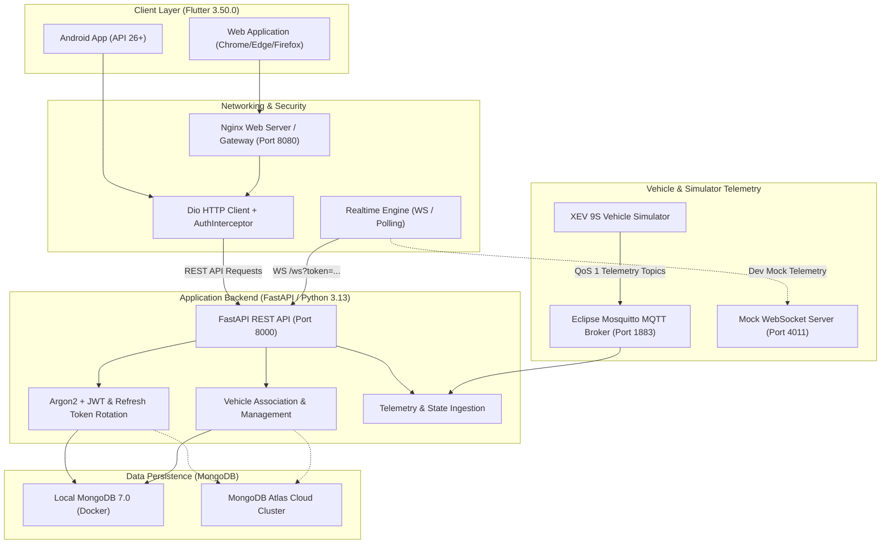

# 🚗⚡ XEV 9S Companion Platform

[](https://github.com/vaishnavnest/xev9s-companion/actions/workflows/ci.yml)
[](docs/openapi.yaml)
[](frontend/xev9s_app)
[](backend)
[](backend)
[](docker-compose.yml)
[](.github/workflows/ci.yml)

A connected-vehicle software platform and companion application for the **XEV 9S Electric Vehicle**. The system integrates a cross-platform client (Android & Web), a cloud API service backed by MongoDB, containerized local orchestration via Docker Compose, real-time telemetry streaming (WebSocket & MQTT), and an automated continuous delivery and security verification pipeline.

---

## 📑 Table of Contents

- [System Architecture](#-system-architecture)
- [Component Overview](#-component-overview)
  - [Frontend (Flutter)](#1-frontend-application-flutter)
  - [Backend (FastAPI)](#2-cloud-backend-fastapi)
  - [Database (MongoDB Atlas & Local)](#3-database-layer-mongodb)
  - [Containerization (Docker Compose)](#4-containerization--docker-compose)
  - [CI/CD & Security Pipelines](#5-unified-cicd--devsecops-pipeline)
- [Prerequisites](#-prerequisites)
- [Quick Start](#-quick-start)
  - [Option A: Full Stack with Docker Compose (Recommended)](#option-a-full-stack-with-docker-compose-recommended)
  - [Option B: Local Development / Hybrid Run](#option-b-local-development--hybrid-run)
- [Environment Configuration](#-environment-configuration)
- [Testing & Quality Gates](#-testing--quality-gates)
- [Mocking & Simulation Toolchain](#-mocking--simulation-toolchain)
- [API Contract & Architecture Decisions](#-api-contract--architecture-decisions)
- [Project Directory Structure](#-project-directory-structure)
- [Branching & Contributing](#-branching--contributing)

---

## 🏛 System Architecture

The XEV 9S Companion Platform follows a decoupled multi-tier architecture:



---

## 📦 Component Overview

### 1. Frontend Application (`frontend/xev9s_app`)
- **Framework:** Flutter 3.50.0 / Dart 3.14.0.
- **Targets:** Android Mobile (API 26+) and Web (desktop & responsive mobile viewports).
- **Architecture:** Feature-First Clean Architecture (`Presentation`, `Application`, `Data/Domain`).
- **State Management:** Riverpod 2.x utilizing `vehicleStatusProvider` as the Single Source of Truth (SSoT).
- **Navigation:** `go_router` with declarative authentication route guards, splash screen boot checks, and nested shells.
- **Networking:** `Dio` client with `AuthInterceptor` (automatic JWT Bearer header injection, 401 interception, and token refresh coordination).
- **Persistence:** `flutter_secure_storage` storing credentials using hardware-backed keystores (EncryptedSharedPreferences / Keychain).
- **Core Features Implemented:**
  - Full Authentication Lifecycle (`SplashPage`, `LoginPage`, `RegisterPage`).
  - Garage Management & Pairing (`VehiclesPage`, `AddVehiclePage` via 6-digit PIN).
  - Modal Vehicle Switcher (`VehicleSwitcherSheet`).
  - Live Telemetry Dashboard (`DashboardPage` with battery SoC % hero ring, range, 4-wheel TPMS, temperatures, gear/speed, and remote control triggers).
  - Vehicle Location Tracking (UC-03, `LocationPage`, route `/location`):
    - Interactive map powered by `flutter_map` + `latlong2` with zoom +/- and recenter controls.
    - Live location updates over WebSocket (`vehicle.location`) with smooth camera auto-follow (disables when user pans).
    - Offline / last-known position detection with `StaleBanner` notice and muted marker styling.
    - Neutral empty state when coordinates are unavailable (never invents coordinates or plots at 0,0).
    - Responsive layout: collapsible bottom sheet panel on narrow viewports (<720px), split side-by-side on wide viewports (≥720px).
    - Full screen-reader Semantics support and pure Dart view-model formatting.
  - Charging Management (UC-04, `ChargingPage`, route `/charging`):
    - Real-time overview displaying live connection status, battery SoC with saved target marker, power in kW, and ticking session duration.
    - Consistency engine (`chargingViewProvider`) reconciling live telemetry with the dashboard using timestamp arbitration.
    - Charging target slider dialog/sheet (20–100%) with bidirectional numeric input sync and inline server error handling.
    - Recurring schedule editor with 24h start/end time pickers, overnight span indicator (e.g. 22:00–06:00), day chips, quick shortcuts (Weekdays, Every day), and delete confirmation dialog.
    - Paginated session history (`/charging/sessions`) with status filter chips (Charging, Completed, Interrupted), pull-to-refresh, and infinite scroll.
    - Charging session detail view (`/charging/sessions/:sessionId`) displaying prominent active/interrupted banners, metrics breakdown, and 404 error recovery.
  - Dual Telemetry Transport: WebSocket (`ws://`) and Polling fallback (`http://`).
  - Automatic disconnection and stale telemetry detection (`StaleBanner`).

#### Mapping Technology & Tile Source
- **Packages:** `flutter_map` (^8.3.2) and `latlong2` (^0.10.1) were chosen because they provide a lightweight, dependency-free mapping implementation across Web and Android without requiring proprietary third-party API keys (e.g. Google Maps or Mapbox keys) during local development and CI testing. The tile provider is injected via Riverpod (`mapTileProviderProvider`), enabling network-isolated widget tests.
- **Tile Usage Disclaimer:** *Public OpenStreetMap (OSM) tile servers are utilized strictly for local development and demonstration. Agree a production tile source or commercial SLA with the team before production release, as required by the OSM Foundation Tile Usage Policy.*

### 2. Cloud Backend (`backend/`)
- **Runtime:** Python 3.13, FastAPI, Uvicorn ASGI server.
- **Architecture:** Modular structure (`core`, `models`, `repositories`, `routes`, `schemas`, `services`).
- **Code Standard:** Strict requirement enforcing ≤ 200 lines per Python source file.
- **Security & Authentication:**
  - Password hashing via Argon2 using `pwdlib`.
  - Access tokens: Short-lived HS256 JWTs (configurable 15-minute default).
  - Refresh tokens: Cryptographically secure random opaque strings, stored as SHA-256 hashes.
  - Automatic token rotation with replay detection: reuse of an already-rotated token immediately triggers session revocation.
- **Endpoints Implemented:**
  - Health checks: `GET /health`, `GET /health/db`
  - Authentication: `POST /auth/register`, `POST /auth/login`, `POST /auth/refresh`, `POST /auth/logout`, `GET /auth/me`
  - Vehicle management: `GET /vehicles`, `POST /vehicles/associate`

### 3. Database Layer (MongoDB)
- **Engine:** MongoDB 7.0 (local container) and **MongoDB Atlas** (cloud cluster).
- **Database Name:** `Xev9s_db`.
- **Collections:**
  - `users`: User profiles, normalized lowercase emails, and Argon2 password hashes.
  - `sessions`: Session tracking, refresh token hashes, rotated token history, and revocation timestamps.
  - `vehicles`: Registered vehicle hardware specifications and model information.
  - `user_vehicles`: Multi-tenant vehicle ownership and driver association mapping.
- **Automated Indexing:**
  - `uq_users_email` (unique index on `users.email`).
  - `uq_sessions_refresh_token` (unique index on `sessions.refresh_token_hash`).

### 4. Containerization & Docker Compose
- **`docker-compose.yml`:** Coordinates a three-service environment running on an isolated bridge network (`xev9s-network`):
  1. `mongodb`: Official Mongo 7.0 container with persistent named volume and healthcheck ping.
  2. `backend`: Multi-stage Python 3.13-slim build running under a non-root user with health probes against `/health`.
  3. `frontend`: Multi-stage Flutter Web build compiled into static assets and served via Alpine Nginx.
- **Security Hardening:** Nginx is explicitly configured to run as non-root (`USER nginx`), satisfying Aquasecurity Trivy `DS-0002` compliance checks.

### 5. Unified CI/CD & DevSecOps Pipeline
A single, automated GitHub Actions workflow (`.github/workflows/ci.yml`) gates all pull requests:
- **Path-Based Triggering:** Skips unaffected jobs when modifying documentation or single sub-packages.
- **Frontend Quality Gate:**
  - Static analysis: `flutter analyze` (0 errors / 0 warnings required).
  - Test suite: `flutter test --coverage`.
  - **Mandatory 70.0% Line Coverage:** Parsed via `lcov`; fails build if coverage falls below threshold (currently at **81.55%**).
  - HTML test coverage report artifact generation.
- **Backend Quality Gate:**
  - Source file size check: Enforces ≤ 200 lines per file across `backend/app`.
  - Linting & formatting: `ruff check .`.
  - FastAPI schema verification: Validates OpenAPI structure on application startup.
  - **Mandatory 70.0% Test Coverage:** Verified via `pytest --cov=backend.app` (currently at **100%**).
  - HTML coverage report artifact upload.
- **Automated Security Scans:**
  - **Gitleaks:** Full-depth commit history scanning for leaked secrets and keys.
  - **Semgrep SAST:** Static application security analysis for common vulnerabilities.
  - **Trivy:** Container image and filesystem scanner blocking on High/Critical vulnerabilities.
- **Mandatory CI Gate:** Blocks pull request merges if any verification or security job fails.

---

## 🛠 Prerequisites

| Component | Minimum Version | Purpose |
|:---|:---|:---|
| **Docker & Docker Compose** | v24.0+ | Local full-stack containerized execution |
| **Flutter SDK** | 3.50.0 (Dart 3.14.0) | Client-side mobile and web compilation |
| **Python** | 3.13+ | Backend execution, scripts, and mock servers |
| **Node.js** | 20+ (LTS) | Optional for running Prism OpenAPI mocks locally |
| **Google Chrome** | Latest | Recommended target for Flutter Web development |
| **Android Studio / SDK** | API 26+ | For Android emulator development |

---

## 🚀 Quick Start

### Option A: Full Stack with Docker Compose (Recommended)

To build and spin up the complete platform (Database, Backend API, and Web App):

```bash
# 1. Clone the repository
git clone https://github.com/vaishnavnest/xev9s-companion.git
cd xev9s-companion

# 2. Start all services in the background
docker-compose up --build -d

# 3. Verify container health status
docker-compose ps
```

Once running, the services are accessible at:
- **Flutter Web App:** [http://localhost:8080](http://localhost:8080)
- **FastAPI Backend API:** [http://localhost:8000](http://localhost:8000)
- **FastAPI Interactive Docs (Swagger):** [http://localhost:8000/docs](http://localhost:8000/docs)
- **Backend Healthcheck:** [http://localhost:8000/health](http://localhost:8000/health)
- **MongoDB Database:** `mongodb://localhost:27017`

To shut down the stack:
```bash
docker-compose down
```

---

### Option B: Local Development / Hybrid Run

If actively developing frontend or backend code outside of Docker:

#### 1. Start Database
Run MongoDB locally via Docker:
```bash
docker run -d --name xev9s-mongo -p 27017:27017 -e MONGO_INITDB_DATABASE=Xev9s_db mongo:7.0
```
*(Or provide a MongoDB Atlas cloud URI in `.env`).*

#### 2. Run the FastAPI Backend
```bash
# Navigate to backend directory
cd backend

# Create and activate virtual environment
python -m venv .venv
# On Windows:
.venv\Scripts\activate
# On macOS/Linux:
source .venv/bin/activate

# Install dependencies
pip install -r requirements.txt
pip install pytest pytest-cov ruff

# Set required environment variables
export MONGO_URI="mongodb://localhost:27017"
export MONGO_DB_NAME="Xev9s_db"
export JWT_SECRET="your_minimum_32_character_development_secret_key"
export JWT_SECRET_KEY="your_minimum_32_character_development_secret_key"
export VEHICLE_PAIRING_PEPPER="your_vehicle_pairing_pepper_secret"

# Start backend server
uvicorn backend.app.main:app --reload --port 8000
```

#### 3. Run the Flutter Frontend
```bash
# In a new terminal:
cd frontend/xev9s_app

# Install Flutter packages
flutter pub get

# Run on Chrome (Web) connecting to local backend
flutter run -d chrome \
  --dart-define=API_BASE_URL=http://localhost:8000 \
  --dart-define=WS_BASE_URL=ws://localhost:8000/ws \
  --dart-define=REALTIME_MODE=ws

# Or run on Android Emulator (10.0.2.2 routes to host machine)
flutter run -d <emulator_id> \
  --dart-define=API_BASE_URL=http://10.0.2.2:8000 \
  --dart-define=WS_BASE_URL=ws://10.0.2.2:8000/ws \
  --dart-define=REALTIME_MODE=ws
```

VS Code users can also launch directly using the presets in `.vscode/launch.json`.

---

## ⚙️ Environment Configuration

### Backend Variables

| Variable | Required | Default (Dev) | Description |
|:---|:---:|:---|:---|
| `MONGO_URI` / `MONGODB_URI` | Yes | `mongodb://localhost:27017` | MongoDB connection connection string (Local or Atlas) |
| `MONGO_DB_NAME` / `MONGODB_DATABASE` | Yes | `Xev9s_db` | Target MongoDB database name |
| `JWT_SECRET` / `JWT_SECRET_KEY` | Yes | — | Secret key (minimum 32 characters) for signing HS256 JWT tokens |
| `JWT_ACCESS_TOKEN_EXPIRE_MINUTES` | No | `15` | Expiry duration for access tokens |
| `REFRESH_TOKEN_EXPIRE_DAYS` | No | `7` | Expiry duration for refresh sessions |
| `VEHICLE_PAIRING_PEPPER` | Yes | — | Cryptographic pepper used for hashing pairing PINs |

### Frontend Variables (`--dart-define`)

| Variable | Default (Dev) | Accepted Values | Description |
|:---|:---|:---|:---|
| `API_BASE_URL` | `http://localhost:4010` | Valid HTTP URL | Base URL for REST API requests |
| `WS_BASE_URL` | `ws://localhost:4011` | Valid WS URL | Base URL for WebSocket telemetry connection |
| `REALTIME_MODE` | `ws` | `ws`, `polling` | Real-time telemetry transport mechanism |
| `POLL_INTERVAL_SECONDS` | `10` | Positive integer | Polling frequency when `REALTIME_MODE=polling` |

---

## 🧪 Testing & Quality Gates

### Running Frontend Tests
```bash
cd frontend/xev9s_app

# 1. Run static analysis
flutter analyze

# 2. Run unit & widget tests
flutter test

# 3. Run tests with coverage generation
flutter test --coverage
```
*Current test suite: **175 passing tests** across 34 suites with **81.55% line coverage**.*

### Running Backend Tests
```bash
# From workspace root
pytest backend/tests \
  --cov=backend.app \
  --cov-report=term-missing \
  --cov-report=html:htmlcov \
  -v
```
*Current backend suite: **100% test coverage** across all modules.*

### Running Security Scanners Locally
```bash
# 1. Secret Scanning with Gitleaks
gitleaks detect --verbose

# 2. Python Code Linting
ruff check backend/

# 3. Trivy Vulnerability Scan
trivy fs --severity HIGH,CRITICAL .
```

---

## 🔬 Mocking & Simulation Toolchain

To facilitate frontend and client development independently of live backend or vehicle simulator instances, the platform provides dedicated mock utilities under `scripts/`:

### 1. REST API Mock Server (Port 4010)
Serves responses adhering strictly to `docs/openapi.yaml`:
```powershell
.\scripts\start-mock.ps1     # PowerShell
./scripts/start-mock.sh      # Bash
```

### 2. WebSocket Telemetry Mock (Port 4011)
Simulates vehicle telemetry streams, location coordinates along a route near Bengaluru (12.9716, 77.5946), and connection state transitions:
```powershell
.\scripts\start-mock-ws.ps1  # PowerShell
./scripts/start-mock-ws.sh   # Bash
```
*Interactive controls in terminal:*
- `c`: Toggle charging on/off.
- `o`: Simulate vehicle going offline (emits last-known location with `isCurrent: false`).
- `n`: Return vehicle online.
- `l`: Inject null coordinates to test the "Location unavailable" (State C) empty state.

### 3. Manual Telemetry Injector (`scripts/inject.py`)
Push specific custom telemetry states or location updates to the mock servers on demand:
```bash
# Set battery to 42%, charging at 48.5 kW
python scripts/inject.py --battery 42.0 --state CHARGING --charging CHARGING --power 48.5

# Simulate driving at 95 km/h
python scripts/inject.py --battery 55.0 --speed 95.0 --state DRIVING --lock LOCKED

# Simulate low battery warning
python scripts/inject.py --battery 12.0 --state PARKED

# Broadcast live vehicle location update
python scripts/inject.py --event vehicle.location

# Broadcast null location (Location Unavailable state)
python scripts/inject.py --event vehicle.location --null-location
```

---

## 📜 API Contract & Architecture Decisions

- **OpenAPI 3.0.3 Contract:** [`docs/openapi.yaml`](docs/openapi.yaml)  
  Canonical contract defining all schemas, parameters, security requirements, and WebSocket push message envelopes.
- **Cross-Stream Decisions Log:** [`docs/open-decisions.md`](docs/open-decisions.md)  
  Formal decision records. Key decisions:
  - **Decision #8:** Eclipse Mosquitto MQTT broker (`mqtt://mosquitto:1883`, QoS 1) selected for Simulator ↔ Backend telemetry transmission and command distribution.
- **Realtime Telemetry Specifications:** [`docs/realtime-notes.md`](docs/realtime-notes.md)  
  Protocol documentation covering WebSocket token query parameters, browser security considerations, and push event catalogs.
- **Frontend Status & Implementation Records:** [`frontend/WEEK_1_STATUS_REPORT.md`](frontend/WEEK_1_STATUS_REPORT.md)  
  Weekly deliverables, coverage metrics, and progress logs.

---

## 📁 Project Directory Structure

```
xev9s-companion/
├── .github/
│   ├── workflows/
│   │   └── ci.yml               # Unified CI & Security GitHub Actions pipeline
│   └── PULL_REQUEST_TEMPLATE.md # Quality gate pull request checklist
├── backend/
│   ├── app/
│   │   ├── core/                # Database, dependencies, exceptions, security
│   │   ├── models/              # MongoDB document definitions (User, Session, Vehicle)
│   │   ├── repositories/        # PyMongo data access objects
│   │   ├── routes/              # FastAPI APIRouters (/auth, /vehicles)
│   │   ├── schemas/             # Pydantic request and response models
│   │   ├── services/            # Business logic and service layer
│   │   └── main.py              # Application entry point and lifespan handler
│   ├── tests/                   # Pytest test suite (100% coverage)
│   ├── Dockerfile               # Multi-stage Python 3.13 production image
│   └── requirements.txt         # Production and development dependencies
├── frontend/
│   ├── WEEK_1_STATUS_REPORT.md  # Detailed weekly engineering status report
│   ├── STRUCTURE.md             # In-depth frontend architectural guide
│   └── xev9s_app/
│       ├── lib/
│       │   ├── app/             # App widget, AppShell, and GoRouter route map
│       │   ├── core/            # Config, network client, token storage, themes
│       │   ├── features/        # Auth, Dashboard, Vehicles, and feature modules
│       │   └── shared/          # Reusable UI widgets and atomic components
│       ├── test/                # Unit and widget test suite (175 tests)
│       └── Dockerfile           # Multi-stage Flutter Web + Nginx production image
├── docs/
│   ├── openapi.yaml             # Canonical OpenAPI 3.0.3 specification
│   ├── open-decisions.md        # Architecture decision log
│   └── realtime-notes.md        # WebSocket and telemetry protocol documentation
├── scripts/
│   ├── inject.py                # CLI telemetry injection tool
│   ├── mock_server.py           # Stateful Python REST mock server
│   ├── mock-ws-server.js        # Node.js WebSocket mock server
│   ├── mock_ws_server.py        # Python WebSocket mock server
│   ├── start-mock.ps1 / .sh     # REST mock startup scripts
│   └── start-mock-ws.ps1 / .sh  # WebSocket mock startup scripts
├── docker-compose.yml           # Multi-service local deployment orchestration
├── package.json                 # Workspace NPM scripts for mock utilities
└── README.md                    # Project documentation (this file)
```

---

## 🌿 Branching & Contributing

- **`main`:** Production-ready releases. Direct pushes are protected.
- **`dev`:** Active integration branch. All feature branches merge here via Pull Request.
- **`feature/<name>`:** Work branches for individual features (e.g., `feature/vehicle-dashboard`).
- **Pull Request Requirements:**
  - Must pass all checks in `.github/workflows/ci.yml` (Flutter verify, backend verify, security scans, coverage gates).
  - Code changes must adhere to the 200-line source limit for backend Python files.
  - Complete the quality verification checklist defined in `.github/PULL_REQUEST_TEMPLATE.md`.
