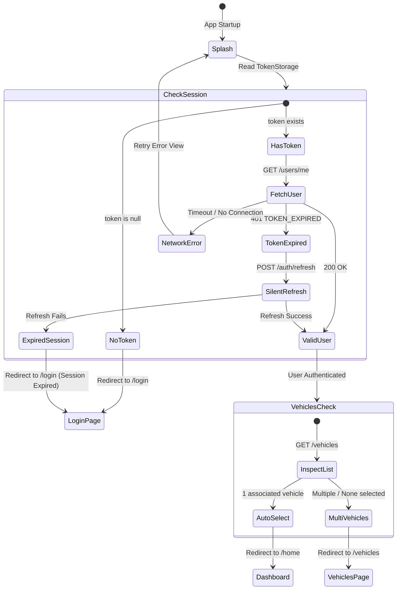

# XEV 9S Companion App

A connected-vehicle companion app for the XEV 9S electric vehicle, built with Flutter for **Android** and **Web**. The app provides real-time vehicle status, charging management, trip history, remote commands, and notifications — all powered by a REST API defined in an OpenAPI 3.0.3 contract.

## Prerequisites

| Tool | Version | Notes |
|------|---------|-------|
| Flutter | 3.50.0+ (stable) | Includes Dart 3.14.0 |
| Chrome | Latest | For web development |
| Android Studio | Latest | For Android emulator and SDK |
| Node.js | LTS (20+) | Required for the Prism mock server |

## Getting Started

```bash
# Clone the repository
git clone <repo-url>
cd xev9s-companion

# Install Flutter dependencies
cd frontend/xev9s_app
flutter pub get
```

## Running the Mock Backends

Local development utilizes two lightweight mock services:
1. **REST API Mock (Port 4010)**: [Prism](https://stoplight.io/open-source/prism) serves the OpenAPI contract with example responses, or the stateful Python mock (`scripts/mock_server.py`).
2. **WebSocket Mock Server (Port 4011)**: A Node.js mock WebSocket server (`scripts/mock-ws-server.js`) that simulates live vehicle telemetry, status broadcasts, and connectivity drops.

### 1. Start REST Mock (Port 4010)
```powershell
# From repository root — PowerShell
.\scripts\start-mock.ps1

# Or bash
./scripts/start-mock.sh

# Or directly via Prism CLI
npx @stoplight/prism-cli mock docs/openapi.yaml -p 4010 --cors
```

### 2. Start WebSocket Mock (Port 4011)
```powershell
# From repository root — PowerShell
.\scripts\start-mock-ws.ps1

# Or bash
./scripts/start-mock-ws.sh

# Or directly via npm
npm run mock:ws
```
> **Interactive Controls**: In the WebSocket mock terminal, press `o` to simulate going offline, `n` to go back online, `c` to toggle charging, or `q` to quit.

## Running the App

Start both mock servers first, then run the app:

```bash
cd frontend/xev9s_app

# Chrome (Web) - WebSocket mode (default)
flutter run -d chrome \
  --dart-define=API_BASE_URL=http://localhost:4010 \
  --dart-define=WS_BASE_URL=ws://localhost:4011 \
  --dart-define=REALTIME_MODE=ws

# Chrome (Web) - Polling mode (re-fetches REST every 5s)
flutter run -d chrome \
  --dart-define=API_BASE_URL=http://localhost:4010 \
  --dart-define=REALTIME_MODE=polling \
  --dart-define=POLL_INTERVAL_SECONDS=5

# Android emulator (10.0.2.2 maps to host localhost)
flutter run -d <emulator-id> \
  --dart-define=API_BASE_URL=http://10.0.2.2:4010 \
  --dart-define=WS_BASE_URL=ws://10.0.2.2:4011 \
  --dart-define=REALTIME_MODE=ws
```

VS Code users: use the pre-configured **"Web (mock)"** or **"Android emulator (mock)"** launch configurations in `.vscode/launch.json`.

## Configuration

| Variable | Purpose | Default | Accepted Values |
|----------|---------|---------|-----------------|
| `API_BASE_URL` | Base URL for REST API calls | `http://localhost:4010` (mock) | e.g. `http://localhost:8080/api/v1` |
| `WS_BASE_URL` | Base URL for WebSocket connection | `ws://localhost:4011` | e.g. `wss://api.example.com` |
| `REALTIME_MODE` | Live telemetry transport mode | `ws` | `ws`, `polling` |
| `POLL_INTERVAL_SECONDS` | Interval between REST polls in polling mode | `10` | Positive integer (seconds) |

These are injected at compile time via `--dart-define`. See `lib/core/config/app_config.dart`.

## Architecture & Realtime Telemetry

### Single Source of Truth: `vehicleStatusProvider`
To ensure data consistency across features:
- **All screens read `vehicleStatusProvider`.**
- No screen, widget, or sub-view calls `GET /vehicles/{id}/status` directly or subscribes directly to the raw WebSocket stream.
- The provider handles initial REST fetch, WebSocket/polling lifecycle, deduplication, out-of-order discarding, and merging partial updates.

### Supported Real-Time Push Events

| Event Name | Schema Type | Handled in VehicleStatus | Description |
|------------|-------------|--------------------------|-------------|
| `vehicle.status` | `VehicleStatus` | Complete replacement | Full telemetry update (battery, range, speed, odometer, lock state). |
| `charging.updated` | `ChargingOverview` | Partial merge | Updates charging state, charging power (kW), and battery level. |
| `connectivity.changed` | `ConnectivityStatus` | Status & stale toggle | Sets connectivity to `ONLINE` or `OFFLINE`, activates `StaleBanner`, and nulls live-only fields. |
| `vehicle.location` | `VehicleLocation` | Parsed safely | GPS coordinate updates (for Map/Location view). |
| `command.updated` | `Command` | Parsed safely | Remote command execution status (Lock/Unlock/Climate). |
| `notification.created` | `Notification` | Parsed safely | Alert and push notification dispatch. |

*Unknown event types are handled gracefully without disconnecting the client or throwing exceptions.*

## Testing

```bash
cd frontend/xev9s_app

# Static analysis
flutter analyze

# Run unit tests
flutter test

# Run tests with coverage
flutter test --coverage
```

## Project Structure

```
xev9s-companion/
├── docs/
│   ├── openapi.yaml          # API contract (source of truth)
│   └── open-decisions.md     # Cross-team decision log
├── scripts/
│   ├── start-mock.sh         # Start mock server (bash)
│   └── start-mock.ps1        # Start mock server (PowerShell)
├── frontend/
│   └── xev9s_app/
│       ├── lib/
│       │   ├── core/          # Cross-cutting: config, networking, errors
│       │   │   └── config/    # AppConfig (dart-define based)
│       │   ├── features/      # Feature-first modules (planned)
│       │   ├── shared/        # Shared widgets, utilities (planned)
│       │   └── app/           # App-level setup, routing (planned)
│       ├── test/              # Mirrors lib/ structure
│       └── pubspec.yaml
├── backend/                   # Backend service (separate)
├── simulator/                 # Vehicle simulator (separate)
└── package.json               # npm scripts (mock server)
```

## Branching and Pull Requests

- Feature branches: `feature/<name>` → merge into `dev`
- No direct commits to `main` or `dev`
- Release flow: `dev` → `main` via reviewed PR

## API Contract

- **OpenAPI spec:** [`docs/openapi.yaml`](docs/openapi.yaml)
- **Decision log:** [`docs/open-decisions.md`](docs/open-decisions.md)

**Rule:** Change the YAML first, then update the code. The OpenAPI file is the source of truth for the API contract. Every endpoint, schema, or constraint change must be reflected in `docs/openapi.yaml` before any Dart code is written.

## Known Limitations of the Mock Server

1. **No WebSocket support** — Prism cannot mock the `/ws` WebSocket endpoint. Real-time updates are not available with the mock.
2. **Static example data** — Prism returns the `example` values from the OpenAPI spec. Responses are not stateful (e.g., creating a resource does not persist it).
3. **No authentication** — Prism does not validate Bearer tokens. Any value (including `Bearer test`) is accepted.

## Troubleshooting

### CORS errors on web

Prism is started with the `--cors` flag which adds permissive CORS headers. If you still see CORS errors:
- Ensure the mock is running (`curl http://localhost:4010/vehicles`)
- Check that you are accessing the app via `localhost`, not `127.0.0.1` (or vice versa)

### `10.0.2.2` on Android emulator

The Android emulator maps `10.0.2.2` to the host machine's `localhost`. Use:
```
--dart-define=API_BASE_URL=http://10.0.2.2:4010
```

### "Connection refused" when the mock is not running

Start the mock server before launching the app:
```powershell
.\scripts\start-mock.ps1
```
Verify it is running: `curl http://localhost:4010/vehicles`

---

## Authentication & Vehicles (UC-01)

### Status & Implemented Features
The Authentication and Vehicle management flows (UC-01) are fully implemented, verified with 125 tests, and passing `flutter analyze` with 0 issues:

- **Authentication (`/login`, `/register`, `/splash`):**
  - Sign in with email/username and password.
  - Sign up with full name, email, and password meeting complexity standards (`>= 8` chars, uppercase, lowercase, digit, special character).
  - Clean error mapping to user-friendly messages for invalid credentials, duplicate email, rate limits, and network errors.
  - Automatic session startup check against `GET /users/me`.
  - Silent token refresh with single-flight locking on 401 `TOKEN_EXPIRED`.
  - Safe logout and session expiration banner handling. Passwords cleared from controllers and memory immediately on submit failure.
- **Vehicle Pairing & Switching (`/vehicles`, `/vehicles/add`, App Shell):**
  - List associated vehicles with connectivity status and model tags.
  - Auto-selects active vehicle when exactly one associated vehicle is available.
  - Association flow via VIN / identifier and in-vehicle 6-digit PIN (`AppConstants.pairingCodeLength = 6`).
  - Vehicle switcher bottom sheet / modal accessible across all shell screens.
  - Active vehicle persists across app restarts via `SharedPreferences`.
  - Clean unpairing / association state isolation.

### Session Lifecycle & Auth Flow



### Pairing Rules & Constants
Defined in `lib/core/constants/app_constants.dart`:
- `pairingCodeLength`: Exactly `6` digits. Must contain numeric digits only (`0-9`).
- `minPasswordLength`: `8` characters. Must include at least 1 uppercase, 1 lowercase, 1 number, and 1 special symbol (`!@#$%^&*(),.?":{}|<>`).
- `maxNameLength`: `100` characters.
- Token refresh proactively occurs on 401 `TOKEN_EXPIRED` or when less than `60` seconds remain before token expiry.

### Mock-Server Testing Commands
With Prism running at `http://localhost:4010`:

```bash
# 1. Register a new user
curl -X POST http://localhost:4010/auth/register \
  -H "Content-Type: application/json" \
  -d '{"name":"Aarav Sharma","email":"aarav@example.com","password":"Password123!"}'

# 2. Login
curl -X POST http://localhost:4010/auth/login \
  -H "Content-Type: application/json" \
  -d '{"identifier":"aarav@example.com","password":"Password123!"}'

# 3. Get Current User (Authenticated)
curl -X GET http://localhost:4010/users/me \
  -H "Authorization: Bearer mock-valid-token"

# 4. List Vehicles
curl -X GET http://localhost:4010/vehicles \
  -H "Authorization: Bearer mock-valid-token"

# 5. Pair Vehicle
curl -X POST http://localhost:4010/vehicles \
  -H "Authorization: Bearer mock-valid-token" \
  -H "Content-Type: application/json" \
  -d '{"identifier":"XEV9S-2026-0001","pairingCode":"123456","name":"Primary Vehicle"}'
```

## Vehicle Dashboard & Real-Time Service (UC-02)

### Status & Implemented Features
The Dashboard and Real-Time Service (UC-02) are fully implemented, verified with 175 tests, and passing `flutter analyze` with 0 issues:

- **Telemetry Dashboard (`/home`):**
  - Displays connected vehicle status: vehicle state chip (`Parked`, `Driving`, `Charging`, `Offline`), connectivity indicator (`Online` / `Offline`), battery level & estimated range, odometer, current speed, lock state (`Locked` / `Unlocked`), preconditioning state, and charging power (kW).
  - Tolerant presentation: Unavailable/missing values display as `"-"` and never `"0"`.
  - Offline presentation: Stale banner with last known timestamp; live telemetry values (speed, charging power) dimmed or omitted per spec.
  - Periodic 30s timer updating relative time ("Updated 2m ago") without rebuilding entire vehicle state.
  - Pull-to-refresh keeping previous telemetry data visible without flashing a blank loading screen (`copyWithPrevious`).
  - Responsive layout: Single column on narrow displays (`< 720px`), two-column adaptive grid on wide displays (`>= 720px`).
  - Quick action shortcuts navigating to Location (`/location`), Charging (`/charging`), and Remote Controls (`/controls`).
- **Real-Time Service (`lib/core/realtime`):**
  - Unified `RealtimeService` interface with implementations for both WebSocket and Polling.
  - Configurable via `--dart-define=REALTIME_MODE=ws|polling` and `--dart-define=POLL_INTERVAL_SECONDS=10`.
  - Auto-reconnect with exponential backoff (`1s, 2s, 4s, 8s, 16s, max 30s`) plus random jitter.
  - Emits synthetic `onResync` signal upon reconnection or polling tick to trigger REST catch-up.
  - Detects expired token close codes (`4001`/`4401`/`401`) and triggers token refresh before retrying.
  - Background lifecycle observer: pauses polling while the app is in the background and resyncs immediately on resume.
- **Single Source of Truth (`vehicleStatusProvider`):**
  - Manages REST fetch, deduplication, out-of-order discarding, and merging push events.
  - Listens to incoming push events (`vehicle.status`, `charging.updated`, `connectivity.changed`).


