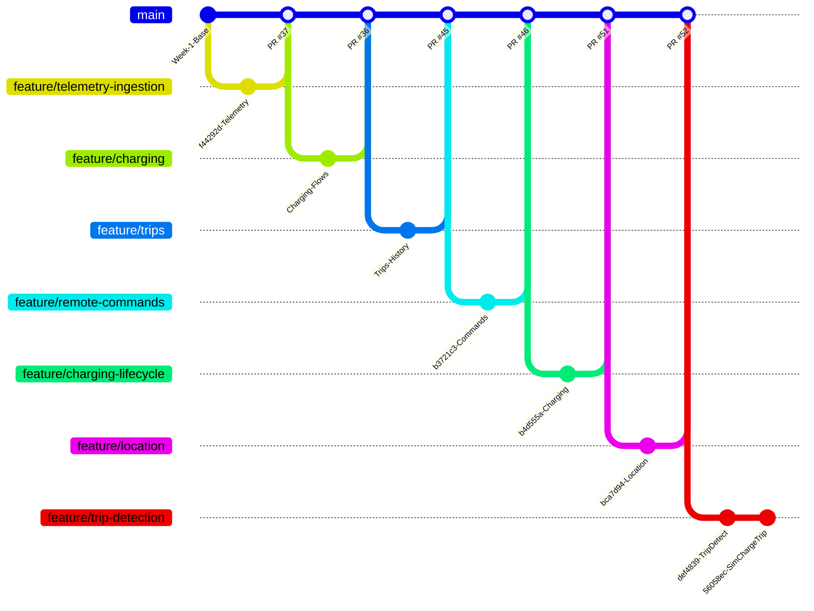
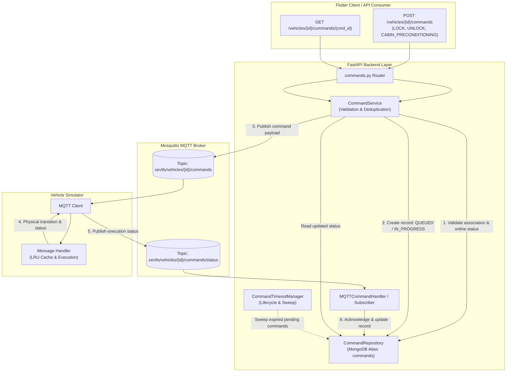
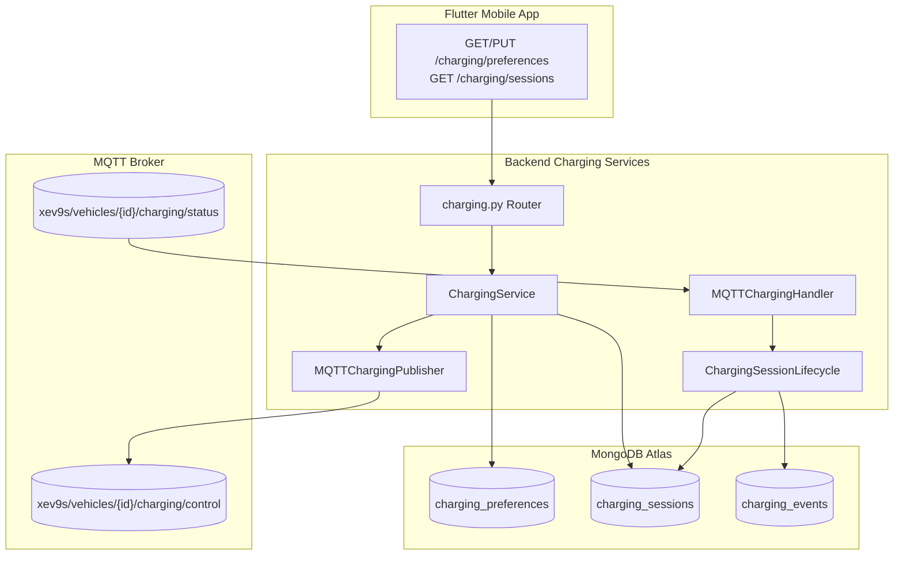

# Week 2 Project Tracking Ledger & Quality Record

**Project:** XEV 9S Companion Application
**Reporting Cycle:** Week 2 (Updated: Friday, November 27, 2026)
**Active Milestone:** Location Management & Reverse Geocoding (PR #52), Trip Detection & Lifecycle (`feature/trip-detection`), Dynamic Simulator Scenarios, Charging Management & Session Lifecycle (PR #51), Remote Vehicle Commands (PR #46), Telemetry Ingestion (PR #37)
**Current Active Branch:** `feature/trip-detection` (branched from `dev` after PR #52 `187ac72`)
**Tracking Document Version:** 5.0 (Updated Friday, November 27, 2026)

---

## 1. Executive Status & Progress Overview

Week 1 finalized the backend foundation, MongoDB Atlas configuration, user authentication/session management, and vehicle pairing credentials (recorded in `backend/WEEK_1_PROJECT_REPORT.md`).

Week 2 captures all engineering work executed between **Friday, November 20, 2026** and **Friday, November 27, 2026**:

### 1.1 Completed Backend Workflows (Implemented & Unit-Tested)
1. **User Authentication & Session Management:**
   - REST endpoints in `backend/app/routes/auth.py` (`/auth/register`, `/auth/login`, `/auth/refresh`, `/auth/logout`, `/auth/me`).
   - JWT access tokens, hashed refresh tokens persisted in `sessions`, and user records in `users` (`auth_service.py`, `security.py`).
2. **Vehicle Management & User-Vehicle Association:**
   - REST endpoints in `backend/app/routes/vehicles.py` (`GET /vehicles`, `POST /vehicles/associate`).
   - Peppered 6-digit pairing PIN verification and user-vehicle ownership tracking (`vehicle_service.py`, `vehicle_repository.py`, `vehicles` & `user_vehicles` collections).
3. **Telemetry Ingestion & Dashboard Updates (PR #37):**
   - Mosquitto MQTT broker configuration, background `MQTTSubscriber`, `TelemetryService`, and MongoDB persistence (`vehicle_telemetry` collection).
   - REST endpoints (`GET /vehicles/{vehicle_id}/telemetry/latest`, `GET /vehicles/{vehicle_id}/telemetry/history`) and real-time WebSocket broadcasting (`WS /ws/vehicles/{vehicle_id}` via `WebSocketManager` & `websocket_notifications.py`).
4. **Remote Vehicle Command Processing (PR #46):**
   - Command dispatch & query REST endpoints (`POST /vehicles/{vehicle_id}/commands`, `GET /vehicles/{vehicle_id}/commands`, `GET /vehicles/{vehicle_id}/commands/{command_id}`).
   - Command lifecycle (`QUEUED` ➔ `IN_PROGRESS` ➔ `SUCCEEDED` / `FAILED` / `TIMEOUT`), validation (`command_validation.py`), `MQTTCommandHandler`, `CommandResponseService`, and automated `CommandTimeoutManager` (`commands` collection).
5. **Charging Management & Session Lifecycle (PR #51):**
   - Charging preferences, session history, and session detail endpoints (`GET /vehicles/{vehicle_id}/charging`, `PUT /vehicles/{vehicle_id}/charging/preferences`, `GET /vehicles/{vehicle_id}/charging/sessions`, `GET /vehicles/{vehicle_id}/charging/sessions/{session_id}`).
   - Session lifecycle state machine (`charging_session_lifecycle.py`, `charging_session_transitions.py`), `ChargingService`, `ChargingEventService`, `MQTTChargingPublisher`, and `MQTTChargingHandler` (`charging_preferences`, `charging_sessions`, `charging_events` collections).
6. **Vehicle Location Management & Reverse Geocoding (PR #52 + `7b8cd68` + `56058ec`):**
   - REST endpoint `GET /vehicles/{vehicle_id}/location` (`backend/app/routes/location.py`).
   - `LocationService` coordinate validation, UTC timestamp normalization, online/offline connectivity freshness check, and `150m` movement threshold caching.
   - `GeocodingService` & `geocoding_formatter.py` providing lazy, rate-limited, thread-safe, cached Nominatim reverse geocoding.
7. **Trip Detection, Recording & Completion (`feature/trip-detection`):**
   - REST endpoints (`GET /vehicles/{vehicle_id}/trips`, `GET /vehicles/{vehicle_id}/trips/{trip_id}` in `backend/app/routes/trips.py`).
   - `TripLifecycleManager`, `TripService`, `TripRepository`, `trip_calculations.py`, and `trip_runtime.py` (`trips` collection with partial unique active-trip index).
   - Automatic trip creation on `driving` telemetry, GPS route-point recording, and trip completion on `parked` / `charging` / `interrupted` states with distance, duration, average speed, and energy consumed calculations plus WebSocket completion notifications.

### 1.2 Implemented Simulator Capabilities (`simulator/`)
1. **Vehicle State Management & Simulation Engine:** `VehicleState`, `VehicleStateManager`, `SimulationEngine`, and `ChargingTracker`.
2. **Telemetry Generation & MQTT Communication:** ISO telemetry generation (`telemetry/generator.py`), `MQTTClient`, `mqtt_handlers.py`, `mqtt_main.py`, and `mqtt_cli.py`.
3. **Vehicle Command Handling:** `MessageHandler` with LRU command deduplication cache, `remote_operations.py`, and `remote_state.py`.
4. **Charging Behaviour & Scenarios:** `CHARGING_TO_TARGET`, `CHARGING_INTERRUPTION`, and dynamic battery charging progression via `ChargingTracker` and `SimulationEngine`.
5. **Route-Based Driving, Finite Journeys & Continuous Driving:** Waypoint routing (`scenarios/route.py`), finite journey completion (`COMPLETED_JOURNEY`), and continuous looping (`DRIVING_ROUTE` with `loop_route=True`).
6. **Connectivity Loss & Restoration Scenarios:** `CONNECTIVITY_LOSS_RESTORE` with configurable `offline_duration_seconds` and `ConnectivityStatus` transitions.
7. **Demonstration Scenario Execution:** `ScenarioManager`, `ScenarioExecutor`, `ScenarioExecutionHandlers`, and `ScenarioConfig` supporting all 9 `ScenarioType` modes (`PARKED_BATTERY_LEVEL`, `DRIVING_ROUTE`, `CHARGING_TO_TARGET`, `CHARGING_INTERRUPTION`, `REMOTE_OP_SUCCESS`, `REMOTE_OP_FAILURE`, `CONNECTIVITY_LOSS_RESTORE`, `LOW_BATTERY`, `COMPLETED_JOURNEY`).

*(Note: Core functionality for the workflows and simulator capabilities above is implemented and unit-tested; individual acceptance criteria and full API/live-integration coverage remain subject to final verification as noted in Section 5.)*

---

## 2. Key Merged PRs & Feature Commits (Week 2 Cycle)

| PR / Branch | Stream | Scope & Deliverables | Commit / Merge | Status |
|---|---|---|---|---|
| `feature/trip-detection` | `feature/trip-detection` | **Trip Detection, Reverse Geocoding & Dynamic Simulator Scenarios:** • Trip detection, route recording, completion calculations & REST API (`/trips`) • Nominatim reverse geocoding (`GeocodingService`) & UTC normalization • Dynamic battery charging scenario (`CHARGING_TO_TARGET`) & `ChargingTracker` • MQTT resilience & reliability hardening across backend and simulator | Commits: `def4839`, `a3f40f0`, `7b8cd68`, `56058ec` | 🔄 Active Branch (Not yet merged to `dev`) |
| **PR #52** | `feature/vehicle-location-management` | **Vehicle Location Management:** • `GET /vehicles/{vehicle_id}/location` endpoint • `LocationService` coordinate validation & connectivity freshness • Location service, route, and repository unit tests | Commit: `bca7d94` Merge: `187ac72` | ✅ Merged to `dev` |
| **PR #51** | `feature/charging-management-and-session-lifecycle` | **Charging Management & Session Lifecycle Subsystem:** • Charging preferences, sessions, and events API (`/charging/*`) • Session lifecycle state machine (`charging_session_lifecycle.py`) • MQTT charging handler & publisher (`mqtt_charging_*.py`) • Restored command index suite (`test_command_indexes.py`) • Hermetic security test isolation fix (`test_coverage_security.py`) | Commit: `b4d555a` Fix: `2e31cec` Merge: `a99e196` | ✅ Merged to `dev` |
| **PR #49** | `feature/aws-simulation-report-worker` | LocalStack Terraform IaC, SQS/S3 `report-worker`, unit tests, and Trivy/CI gate | Merge: `433d15b` | ✅ Merged to `dev` |
| **PR #46** | `feature/remote-vehicle-command-processing` | **Backend Remote Vehicle Commands Processing (UC-05):** • `commands.py` REST routes (`POST`, `GET`, `GET /{id}`) • `command_service.py` & `command_repository.py` • `mqtt_command_handler.py` & `command_response_service.py` • `command_timeout_manager.py` (automated timeout sweep) | Commit: `b3721c3` Merge: `405fa1f` | ✅ Merged to `dev` |
| **PR #45 / #50** | `feature/trips` | **Trips & History Subsystem (Frontend/Mock):** • Trips presentation screens & history providers • Mock server lifecycle & vehicleState synchronization | Merges: `354964e`, `d600af5` | ✅ Merged to `dev` |
| **PR #44** | `feature/remote-controls` | Remote controls header and layout adjustments | Merge: `18c0aa0` | ✅ Merged to `dev` |
| **PR #43 / #42 / #47** | `feature/image-build-pipeline` | Container image build pipeline optimization, OS package upgrades & Trivy scan gate | Merges: `8c3a859`, `655ae62` | ✅ Merged to `dev` |
| **PR #39 / #38** | `feature/remote-controls` | Client remote controls page & state management | Merge: `a609f63` | ✅ Merged to `dev` |
| **PR #37** | `feature/vehicle-telemetry-ingestion-and-dashboard-updates` | **Workflow 3 / Telemetry Ingestion Subsystem:** • Mosquitto MQTT broker config (1883/9001) • Background MQTT subscriber & WebSocket manager • REST `/telemetry/latest` & `WS /ws/vehicles/{id}` • Simulator MQTT client & message handler | Commit: `f44292d` Merge: `73c51f8` | ✅ Merged to `dev` |
| **PR #36 / #34** | `feature/charging` | Charging overview screen, target sliders, and session history | Merge: `59cb5f9` | ✅ Merged to `dev` |
| **PR #35** | `feature/image-build-pipeline` | Container image pipeline, Trivy scans, Syft SBOMs | Merge: `b73cae3` | ✅ Merged to `dev` |

---

## 3. Subsystem Architecture Overview

### 3.1 Remote Commands Subsystem Architecture (PR #46)

### 3.2 Charging Management & Session Lifecycle Architecture

---

## 4. Quality & Verification Metrics (November 27, 2026)

### 4.1 Independently Executed & Verified Test Coverage

Both test suites below were independently executed and verified prior to this documentation update; the results recorded here are those verified figures (no new coverage reports were generated during this documentation update).

**Documented Coverage-Generation Commands:**
- **Backend:** `python -m pytest backend/tests --cov=backend/app --cov-report=term-missing --cov-report=html:backend/htmlcov`
- **Simulator:** `python -m pytest simulator/tests --cov=simulator --cov-report=term-missing --cov-report=html:simulator/htmlcov`

| Component | Tests Passed | Statements | Missed Statements | Coverage |
|---|---:|---:|---:|---:|
| **Backend** | 543 | 2,481 | 20 | **99%** |
| **Simulator** | 281 | 2,486 | 37 | **99%** |
| **Total** | **824** | **4,967** | **57** | **99% each** |

### 4.2 Automated Test & Static Analysis Verification
- **Backend Test Suite:** 543 passed (80 test files in `backend/tests/`).
- **Simulator Test Suite:** 281 passed (25 test files in `simulator/tests/`).
- **Ruff Lint Checks:** Passed across `backend/` and `simulator/`.
- **Python Application Source-File Length Check:** All Python application source files (`backend/app/`: 71 files; `simulator/` non-test modules: 21 files) are strictly below 200 lines.
- **Git Hygiene (`git diff --check`):** Passed with no whitespace errors or conflict-marker issues.
- **Database Index Coverage:** All 10 core collections verified in `backend/app/core/indexes.py` (`users`, `sessions`, `vehicles`, `user_vehicles`, `vehicle_telemetry`, `commands`, `charging_preferences`, `charging_sessions`, `charging_events`, `trips`).

### 4.3 Live Integration Verification (Verified Scope)
The following live integration checks were verified independently from automated unit tests (this does not imply that all possible live integration scenarios or edge cases have been tested end-to-end):
- **MongoDB Atlas Connectivity:** Verified via the FastAPI database health endpoint (`GET /health/database`).
- **MQTT Broker Availability:** Verified on `127.0.0.1:1884`.
- **Simulator MQTT Flow:** Verified that the MQTT simulator successfully connected, subscribed, and published telemetry.
- **Backend Telemetry Ingestion:** Verified that the FastAPI backend received and persisted simulator telemetry, confirmed through the telemetry API.

---

## 5. Remaining Work & Open Gaps

### 5.1 Incomplete Workflows & Acceptance Criteria
The following workflows and acceptance criteria are **not yet complete** and remain pending:
- **Driving and energy analytics** (backend endpoints/services not yet implemented).
- **Vehicle events and notifications** (general vehicle event/notification endpoints and alert workflows not yet implemented beyond charging/trip WebSocket notifications).
- **Connectivity monitoring** (dedicated connectivity monitoring/alerting workflow not yet implemented beyond basic freshness checks in location/commands).
- **Historical data retrieval** (broader historical query/aggregation endpoints beyond existing `/telemetry/history`, `/trips`, and `/charging/sessions`).
- **Report generation and retrieval** (`report-worker/` SQS/S3 worker and Terraform IaC exist, but backend report generation/retrieval API endpoints are not yet implemented).
- **Remaining acceptance criteria for simulated vehicle operation/state management** (full end-to-end verification against all project acceptance criteria).
- **Remaining acceptance criteria for demonstration scenario management** (full end-to-end verification of all scenario lifecycle and live MQTT/backend interactions).

### 5.2 Outstanding API Contract Alignment & Integration Work
As documented in `API_CONTRACT_AUDIT_REPORT.md`, alignment work remains between `backend/app`, `simulator/`, `frontend/xev9s_app`, and `docs/openapi.yaml`:
- **Response & Error Envelopes:** OpenAPI/Flutter expect `{ success, data, meta, error }` envelopes; backend routes currently return bare JSON models and standard FastAPI `{"detail": ...}` errors.
- **JSON & Enum Casing:** OpenAPI/Flutter expect `camelCase` keys and `UPPER_SNAKE_CASE` enums, whereas backend schemas predominantly use `snake_case` and lowercase enum values.
- **Routing, Base Prefix & WebSocket Framing:** OpenAPI specifies `/api/v1` prefix, `GET /ws?token=...&vehicleId=...`, and event envelopes `{ event, vehicleId, timestamp, data }`, whereas backend mounts routes at root and serves `WS /ws/vehicles/{vehicle_id}`.
- **MQTT Topic Alignment:** Backend and simulator use `xev9s/vehicles/{id}/...` topics rather than `docs/openapi.yaml`'s `vehicle/{id}/...` topic convention.
- **Branch Integration:** `feature/trip-detection` changes (`def4839`..`56058ec`) are not yet merged into `dev`.

---

## 6. Week 2 Completed Activity Log

| Day | Milestone / Stream | Status & Deliverables |
|---|---|---|
| **Fri – Sun (Nov 20–22)** | Simulator Core | State machine, simulation engine, telemetry generator, scenarios, initial unit tests. |
| **Mon (Nov 23)** | Setup & Baseline | Established tracker; added `paho-mqtt`; verified initial test baseline. |
| **Tue (Nov 24)** | Telemetry Ingestion (PR #37) | Completed Workflow 3; Mosquitto broker setup, MQTT subscriber, WebSocket manager, REST routes; seeded 10 development vehicles with 6-digit numeric PINs. |
| **Wed (Nov 25)** | Remote Commands (PR #46) | Completed UC-05 Remote Commands Subsystem (dispatch, lifecycle, MQTT handlers, timeout manager); merged Trips frontend (PR #45). |
| **Thu (Nov 26)** | Charging Lifecycle & Report Worker (PR #51, PR #49) | Implemented Charging Management & Session Lifecycle Subsystem; restored command index tests; resolved CI test isolation; merged LocalStack `report-worker` IaC (PR #49). |
| **Fri (Nov 27)** | Location, Reverse Geocoding, Trip Detection & Dynamic Scenarios (PR #52 + `feature/trip-detection`) | Merged Vehicle Location Management (PR #52); implemented Nominatim reverse geocoding, Trip Detection & Lifecycle, UTC normalization, and dynamic battery charging simulator scenario; recorded verified 99% coverage (543 backend + 281 simulator = 824 tests passed) and live MongoDB/MQTT integration checks. |

---
*Updated through Friday, November 27, 2026.*
