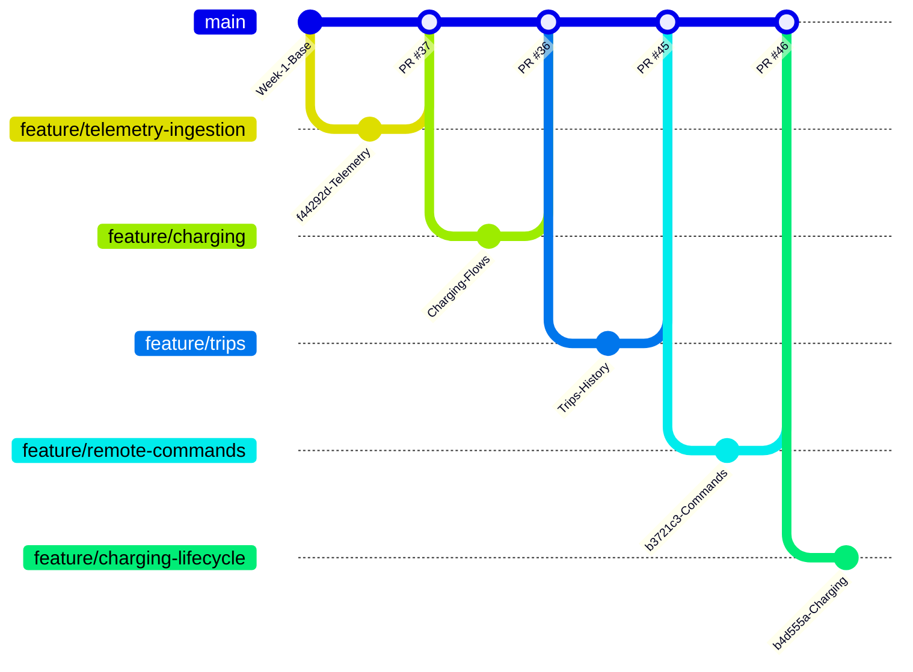
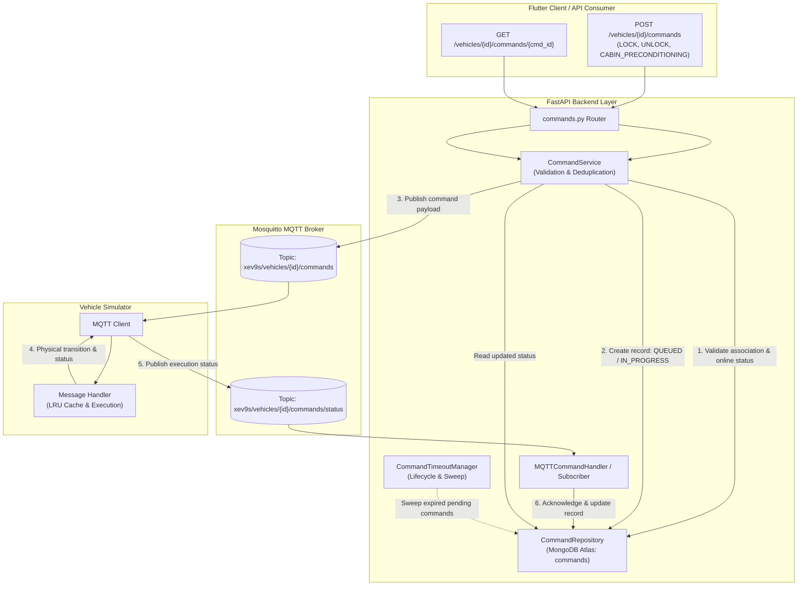
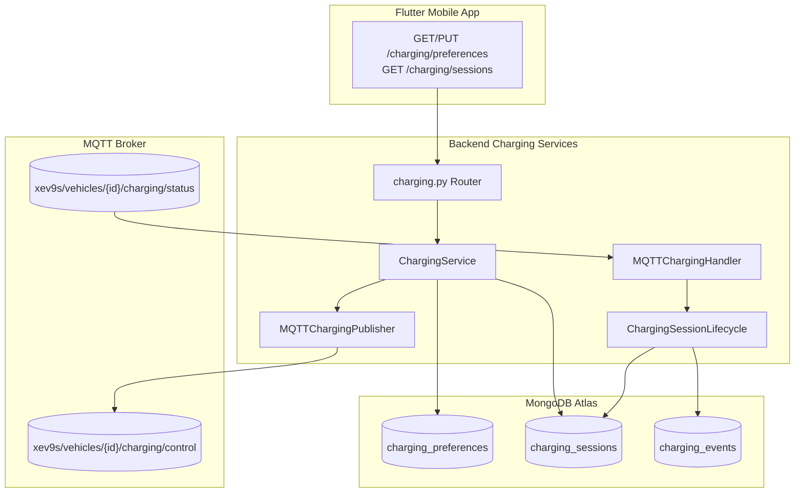

# Week 2 Project Tracking Ledger & Quality Record

**Project:** XEV 9S Companion Application  
**Reporting Cycle:** Week 2 (Final Cutoff: Thursday, November 26, 2026)  
**Active Milestone:** Charging Management & Session Lifecycle (PR #51), 100% Backend Test Coverage, Remote Vehicle Commands (PR #46), Telemetry Ingestion (PR #37), Trips & History (PR #45)  
**Current Active Branch:** `dev` (Merged PR #51 via `a99e196`)  
**Tracking Document Version:** 4.0 (Final Cutoff Thursday, November 26, 2026)  

---

## 1. Executive Status & Progress Overview

Week 1 finalized the backend foundation, MongoDB Atlas configuration, user authentication/session management, and vehicle pairing credentials (recorded in `backend/WEEK_1_PROJECT_REPORT.md`).

Week 2 captures all engineering work executed between **Friday, November 20, 2026** and **Thursday, November 26, 2026**, leading directly into today's **Week 2 Status Report (Report 2)**:
1. **Vehicle Simulator Subsystem:** Realistic vehicle state machine, ISO telemetry generation, route/battery physics, and resilient MQTT streaming (`simulator/` - 256 unit tests, 99% coverage).
2. **Telemetry Ingestion & Real-Time Sync (PR #37):** Mosquitto MQTT broker configuration, background FastAPI subscriber, MongoDB Atlas persistence, and real-time WebSocket broadcasting.
3. **Remote Vehicle Command Processing (PR #46):** 
   - Command dispatch API (`POST /vehicles/{id}/commands`), query history, and status tracking.
   - Command lifecycle management: `QUEUED` ➔ `IN_PROGRESS` ➔ `SUCCEEDED` / `FAILED` / `TIMEOUT`.
   - MQTT command publisher & response handler (`mqtt_command_handler.py`).
   - Automated timeout manager (`command_timeout_manager.py`).
4. **Trips & History Subsystem (PR #45):** Frontend & mock server integration for trip recording and analytics.
5. **Charging Management & Session Lifecycle Subsystem (Commit `b4d555a`):**
   - Full charging data models (`ChargingPreference`, `ChargingSession`, `ChargingEvent`).
   - Repositories (`charging_repository.py`, `charging_session_repository.py`, `charging_event_repository.py`).
   - Services (`charging_service.py`, `charging_session_lifecycle.py`, `charging_session_transitions.py`, `charging_runtime.py`, `charging_event_service.py`).
   - REST API routes (`backend/app/routes/charging.py`) and MQTT publishers/handlers.
   - Central database indexes for charging collections in `backend/app/core/indexes.py`.
6. **100% Backend Automated Test Coverage & CI Hardening:**
   - Raised backend coverage to **100%** across all 53 backend application modules (1,678 / 1,678 statements, 0 missed).
   - Restored central command database index testing in dedicated test file `backend/tests/test_command_indexes.py`.
   - Resolved CI pipeline failure in `test_coverage_security.py` using `monkeypatch` for environment-independent hermetic testing.
7. **Platform Quality & Compliance Totals:**
   - **655 automated tests** passing across the platform with 0 failures (399 backend + 256 simulator).
   - 100% compliance with strict **<= 200 lines per file** limit across all 53 backend app files, 37 simulator files, and all new test files.
   - **0 Ruff linting errors / warnings** across both `backend` and `simulator`.

---

## 2. Key Merged PRs & Feature Commits (Week 2 Cycle)

| PR / Branch | Stream | Scope & Deliverables | Commit / Merge | Status |
|---|---|---|---|---|
| **PR #51** | `feature/charging-management-and-session-lifecycle` | **Charging Management & Session Lifecycle Subsystem:** • Charging preferences, sessions, and events API (`/charging/*`) • Session lifecycle state machine (`charging_session_lifecycle.py`) • MQTT charging handler & publisher (`mqtt_charging_*.py`) • 100% backend test coverage (399 backend tests passing) • Restored command index suite (`test_command_indexes.py`) • Hermetic security test isolation fix (`test_coverage_security.py`) | Commit: `b4d555a` Fix: `2e31cec` Merge: `a99e196` | ✅ Merged to `dev` |
| **PR #46** | `feature/remote-vehicle-command-processing` | **Backend Remote Vehicle Commands Processing (UC-05):** • `commands.py` REST routes (`POST`, `GET`, `GET /{id}`) • `command_service.py` & `command_repository.py` • `mqtt_command_handler.py` & `command_response_service.py` • `command_timeout_manager.py` (automated timeout sweep) • 7 new test files (+65 unit tests) | Commit: `b3721c3` Merge: `405fa1f` | ✅ Merged to `dev` |
| **PR #45** | `feature/trips` | **Trips & History Subsystem (UC-06):** • Trips presentation screens & history providers • Mock server lifecycle & vehicleState synchronization • Remote controls rocker UI refinements | Merge: `354964e` | ✅ Merged to `dev` |
| **PR #44** | `feature/remote-controls` | Remote controls header and layout adjustments | Merge: `18c0aa0` | ✅ Merged to `dev` |
| **PR #43 / #42** | `feature/image-build-pipeline` | Container image build pipeline optimization & Trivy scan gate | Merge: `8c3a859` | ✅ Merged to `dev` |
| **PR #39 / #38** | `feature/remote-controls` | Client remote controls page & state management | Merge: `a609f63` | ✅ Merged to `dev` |
| **PR #37** | `feature/vehicle-telemetry-ingestion-and-dashboard-updates` | **Workflow 3 / Telemetry Ingestion Subsystem:** • Mosquitto MQTT broker config (1883/9001) • Background MQTT subscriber & WebSocket manager • REST `/telemetry/latest` & `WS /ws/vehicles/{id}` • Simulator MQTT client & message handler | Commit: `f44292d` Merge: `73c51f8` | ✅ Merged to `dev` |
| **PR #36 / #34** | `feature/charging` | Charging overview screen, target sliders, and session history | Merge: `59cb5f9` | ✅ Merged to `dev` |
| **PR #35** | `feature/image-build-pipeline` | Container image pipeline, Trivy scans, Syft SBOMs | Merge: `b73cae3` | ✅ Merged to `dev` |

---

## 3. Subsystem Architecture Overview

### 3.1 Remote Commands Subsystem Architecture (PR #46)

### 3.2 Charging Management & Session Lifecycle Architecture

---

## 4. Quality & Verification Metrics (Thursday Final Cutoff)

### 4.1 Automated Test Execution Summary

| Subsystem | Test Files | Total Tests | Passed | Failed | Pass Rate | Execution Time |
|---|---|---|---|---|---|---|
| **FastAPI Backend** | 53 test files | **399** | 399 | 0 | **100%** | ~2.8s |
| **Vehicle Simulator** | 19 test files | **256** | 256 | 0 | **100%** | ~0.66s |
| **Combined Platform Total** | **72 test files** | **655** | **655** | **0** | **100%** | **~3.5s** |

### 4.2 Code Coverage Metrics
- **Backend Subsystem Coverage:** **100%** (1,678 / 1,678 statements covered across all 53 application modules, 0 missed).
- **Simulator Subsystem Coverage:** **99%** (2,048 statements evaluated).
- **Combined Codebase Coverage:** **~99.5%**.

### 4.3 Static Analysis & File Size Constraint
- **File Length Guard (< 200 lines per `.py` file):**
  - **Backend (53 production `.py` files in `backend/app/`):** 100% compliant (0 violations).
  - **Simulator (37 files in `simulator/`):** 100% compliant (0 violations).
  - **Test Files (53 backend test files):** All newly added and modified test suites strictly $\le 200$ lines.
- **Ruff Code Quality:**
  - `backend/`: **0 errors / 0 warnings** (clean).
  - `simulator/`: **0 errors / 0 warnings** (clean).
- **Database Index Coverage:** All 9 core collections verified centrally (`users`, `sessions`, `vehicles`, `user_vehicles`, `vehicle_telemetry`, `commands`, `charging_preferences`, `charging_sessions`, `charging_events`).

---

## 5. Week 2 Completed Activity Log

| Day | Milestone / Stream | Status & Deliverables |
|---|---|---|
| **Fri – Sun (Nov 20–22)** | Simulator Core | State machine, simulation engine, telemetry generator, scenarios, 194 unit tests. |
| **Mon (Nov 23)** | Setup & Baseline | Established tracker; added `paho-mqtt`; verified initial test baseline. |
| **Tue (Nov 24)** | Telemetry Ingestion (PR #37) | Completed Workflow 3; Mosquitto broker setup, MQTT subscriber, WebSocket manager, REST routes; seeded 10 development vehicles with 6-digit numeric PINs. |
| **Wed (Nov 25)** | Remote Commands (PR #46) | Completed UC-05 Remote Commands Subsystem (dispatch, lifecycle, MQTT handlers, timeout manager); merged Trips (PR #45); total tests reached 470. |
| **Thu (Nov 26 - Today)** | **Charging Lifecycle & 100% Quality** | Implemented Charging Management & Session Lifecycle Subsystem; raised backend test coverage to **100%** (399 backend tests); restored command index tests; resolved CI test isolation; platform tests reached **655 passed**. Finalized Report 2. |

---
*Verified and ready for final Week 2 Status Report compilation.*
