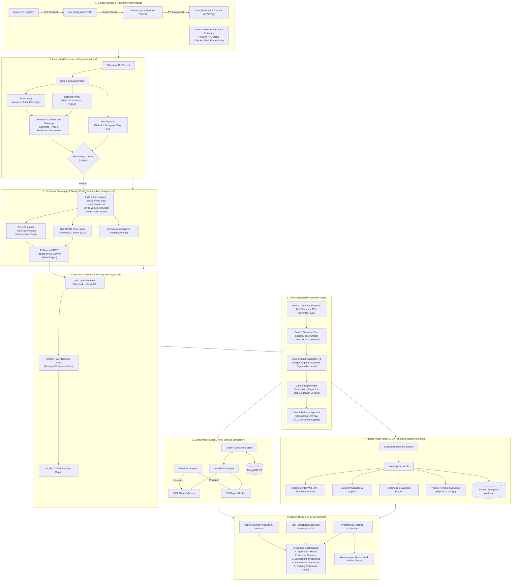

# 🚗⚡ XEV 9S Companion Platform
# Project 3 - Section 4: DevSecOps, CI/CD, AWS Simulation and SRE
## Master Architecture, Engineering Workflows, and Operational Plan

**Author / Engineer:** Vaishnav M (DevOps, DevSecOps & SRE Engineer)  
**Role:** Engineer 3 (Platform & Infrastructure)  
**Document Classification:** Comprehensive Engineering Specification & Architecture Plan  
**Source Specification:** Project 3 - Section 4 – DevSecOps, CI/CD, AWS Simulation and SRE  

---

## 📑 Table of Contents

1. [Executive Summary & Core Objectives](#1-executive-summary--core-objectives)
2. [Deployment Targets & Packaging Strategy](#2-deployment-targets--packaging-strategy)
   - [Target 1: AWS Service Simulation](#target-1--aws-service-simulation)
   - [Target 2: On-Premises Kubernetes](#target-2--on-premises-kubernetes)
   - [The "Build Once, Deploy Everywhere" Principle](#the-build-once-deploy-everywhere-principle)
3. [Application Images & Upstream Infrastructure](#3-application-images--upstream-infrastructure)
4. [Master End-to-End DevOps Architecture Diagram](#4-master-end-to-end-devops-architecture-diagram)
5. [The 11 DevOps Workflows (Start-to-End Project Plan)](#5-the-11-devops-workflows-start-to-end-project-plan)
   - [Workflow 1: Repository and Branch Management](#workflow-1--repository-and-branch-management)
   - [Workflow 2: Automated Continuous Integration (CI) Pipeline](#workflow-2--automated-continuous-integration-ci-pipeline)
   - [Workflow 3: Static Analysis and Security Validation (DevSecOps)](#workflow-3--static-analysis-and-security-validation-devsecops)
   - [Workflow 4: Integration Testing and End-to-End Application Testing](#workflow-4--integration-testing-and-end-to-end-application-testing)
   - [Workflow 5: Build Images and Generate Release Artefacts](#workflow-5--build-images-and-generate-release-artefacts)
   - [Workflow 6: Release Creation and Promotion Gates](#workflow-6--release-creation-and-promotion-gates)
   - [Workflow 7: AWS Service Simulation Deployment (Target 1)](#workflow-7--aws-service-simulation-deployment-target-1)
   - [Workflow 8: On-Premises Kubernetes Deployment (Target 2)](#workflow-8--on-premises-kubernetes-deployment-target-2)
   - [Workflow 9: Deployment Monitoring and Reporting](#workflow-9--deployment-monitoring-and-reporting)
   - [Workflow 10: Observability and Site Reliability Engineering (SRE)](#workflow-10--observability-and-site-reliability-engineering-sre)
   - [Workflow 11: Final Demonstration Plan (11 End-to-End Demonstrations)](#workflow-11--final-demonstration-plan-11-end-to-end-demonstrations)
6. [Operational Lifecycle: How the Platform Operates After Completion](#6-operational-lifecycle-how-the-platform-operates-after-completion)
   - [Day-to-Day Feature Development & CI Quality Gating](#day-to-day-feature-development--ci-quality-gating)
   - [Automated Packaging & Registry Distribution](#automated-packaging--registry-distribution)
   - [Release Promotion Across the 5 Quality Gates](#release-promotion-across-the-5-quality-gates)
   - [Target 1 Operations: Asynchronous Buffer Resilience](#target-1-operations-asynchronous-buffer-resilience)
   - [Target 2 Operations: Kubernetes Self-Healing & Automated Rollback](#target-2-operations-kubernetes-self-healing--automated-rollback)
   - [Live Observability, Telemetry Auditing & SLO Compliance](#live-observability-telemetry-auditing--slo-compliance)

---

## 1. Executive Summary & Core Objectives

The goal of the DevOps engineering stream is to build a fully automated, hardened software delivery and operational reliability environment for the **XEV 9S Companion Application**. 

### Foundational Constraints & Scope Boundaries:
1. **Pure Software Simulation:** The application, backend, and vehicle simulator are software components. There is no physical vehicle, physical hardware connectivity, physical IoT device, or physical cellular network infrastructure.
2. **Pure DevOps & Infrastructure Ownership:** The DevOps engineer builds and maintains repository structures, automated CI/CD pipelines, security validation engines, container build mechanisms, cloud simulation environments, container orchestration clusters, verification harnesses, and telemetry observability stacks.
3. **Strict Quality Gating:** Code cannot progress to integration or release without passing automated unit testing, line coverage thresholds ($\ge 70\%$), secret scans, static code analysis (SAST), vulnerability scans, and dynamic API security analysis.

---

## 2. Deployment Targets & Packaging Strategy

The platform delivers the same application code to two independent production-grade environments:

```
+-----------------------------------------------------------------------------------+
|                           Unified CI/CD Pipeline                                  |
|   (Builds, Scans, Verifies, and Publishes 4 Versioned Application Container Images)|
+-----------------------------------------+-----------------------------------------+
                                          |
                      +-------------------+-------------------+
                      |                                       |
                      v                                       v
+-------------------------------------------+ +-------------------------------------------+
|    Target 1: AWS Service Simulation       | |      Target 2: On-Premises Kubernetes      |
|  - LocalStack (AWS Emulation Engine)      | |  - Kubernetes Cluster (local via kind)    |
|  - Amazon SQS (Report Request Queue)      | |  - Kustomize Manifest Organization        |
|  - Amazon S3 (PDF/CSV Report Storage)     | |  - Namespace: xev9s                       |
|  - Terraform Infrastructure Provisioning  | |  - Ingress, Services, ConfigMaps, Secrets |
|  - Docker Containerized Stack             | |  - PersistentVolumes & PVCs               |
|  - MongoDB Operational Database           | |  - Zero AWS Dependencies                  |
+-------------------------------------------+ +-------------------------------------------+
```

### Target 1 – AWS Service Simulation
* **Purpose:** Emulate an enterprise cloud deployment leveraging AWS managed services without incurring cloud provider costs or requiring live AWS credentials.
* **Technology:** **LocalStack** running inside Docker, exposing AWS-compatible REST endpoints.
* **Services Emulated:**
  * **Amazon SQS:** Provides asynchronous message queues for vehicle trip/energy report generation requests.
  * **Amazon S3:** Object storage bucket storing generated PDF and CSV report files.
* **Infrastructure as Code (IaC):** **Terraform** provisions the SQS queue and S3 bucket against LocalStack.
* **Database:** MongoDB acts as the primary transactional operational database.

### Target 2 – On-Premises Kubernetes
* **Purpose:** Run the identical application platform in an enterprise on-premises Kubernetes environment with zero external AWS dependencies.
* **Technology:** **Kubernetes** (using **`kind`** - Kubernetes in Docker - for development and evaluation demonstrations).
* **Workloads:**
  * Declarative deployments for Flutter Web, FastAPI Backend, Vehicle Simulator, and Report Worker.
  * Stateful MongoDB workload with **PersistentVolumeClaims (PVC)**.
  * Dedicated PersistentVolumes for local report storage.
  * ClusterIP Services for internal microservice communication and Ingress for ingress traffic routing.
  * Kubernetes **Readiness** and **Liveness** probes for automatic health monitoring.
  * Kustomize for clean environment overlay management.

### The "Build Once, Deploy Everywhere" Principle
Docker is used strictly to package and build immutable application images. Kubernetes and Docker Compose are orchestrators. **All 4 application images must be built exactly once by the CI pipeline and deployed unchanged to both Target 1 and Target 2.**

---

## 3. Application Images & Upstream Infrastructure

The CI pipeline compiles, tests, scans, and produces four versioned container images:

| # | Container Image Name | Source Component | Responsibilities & Runtime Environment |
|---|---|---|---|
| 1 | **`xev9s-flutter-web`** | `frontend/xev9s_app` | Multi-stage build (Flutter SDK $\to$ Alpine Nginx unprivileged). Serves responsive Web SPA on port `8080`. |
| 2 | **`xev9s-backend`** | `backend/` | Multi-stage Python 3.13 slim build. Runs FastAPI REST API & WebSocket server on port `8000`. |
| 3 | **`xev9s-vehicle-simulator`**| `simulator/` | Python runtime executing vehicle physics, driving/charging state machines, and MQTT telemetry publishing. |
| 4 | **`xev9s-report-worker`** | `report-worker/` | Python background worker consuming report generation tasks from queues, reading MongoDB records, and generating PDF/CSV files. |

### Upstream Supporting Infrastructure
* **MongoDB:** Uses official, pinned upstream image **`mongo:7.0`** with persistent storage volumes.
* **MQTT Broker:** Uses official, pinned upstream image **`eclipse-mosquitto:2.0`** for IoT pub/sub message exchange.
* **LocalStack:** Uses official, pinned upstream image **`localstack/localstack`** for AWS service emulation.
* *(Upstream images are not compiled by our CI; they are pulled and validated directly from secure upstream registries).*

---

## 4. Master End-to-End DevOps Architecture Diagram



---

## 5. The 11 DevOps Workflows (Start-to-End Project Plan)

### Workflow 1 – Repository and Branch Management
* **Objective:** Establish the source-control foundation and define how code moves securely from development to production release.
* **What to Build:**
  1. Git repository configured for the whole project team.
  2. Primary branches: `main` (production-ready) and `dev` (active integration).
  3. Release branch convention: `release/x.y.z` (e.g. `release/1.0.0`).
  4. Work branch conventions: `feature/<name>` and `bugfix/<name>`.
  5. Pull request template: `.github/PULL_REQUEST_TEMPLATE.md` with quality checklists, local command verification reminders, and coverage statements.
  6. GitHub Rulesets / Branch Protection on `dev`, `release/*`, and `main`:
     - Require pull request before merging.
     - Block direct force pushes (`git push --force`).
     - Restrict branch deletions.
     - Require status checks to pass (`Mandatory CI Gate`).
  7. GitHub Actions workflow triggers on pull requests targeting `dev`, `release/*`, and `main`.
* **Branching Lifecycle Sequence:**
  1. Developer cuts `feature/vehicle-dashboard` from `dev`.
  2. Implements feature code and unit tests.
  3. Pushes changes and opens a PR to `dev`.
  4. GitHub Actions triggers and runs CI validation automatically.
  5. Reviewer validates code, test results, and security findings.
  6. PR merges to `dev` only after CI passes.
  7. When release features are complete, cut `release/1.0.0` from `dev` (scope freeze).
  8. Fix defects directly on `release/1.0.0` (no new features added).
  9. Test release candidate on both deployment targets.
  10. Merge `release/1.0.0` into `main`, tag `v1.0.0`, and back-merge fixes to `dev`.
  11. *Hotfixes:* Branch from `main`, validate, merge to `main`, tag, and merge back to `dev`.
* **Demonstration 1:** Create feature branch $\to$ Push code $\to$ Open PR $\to$ CI triggers $\to$ Show failed check blocking merge $\to$ Fix defect $\to$ PR becomes eligible $\to$ Create release branch $\to$ Merge to `main` $\to$ Create version tag.

---

### Workflow 2 – Automated Continuous Integration (CI) Pipeline
* **Objective:** Automatically validate source code on every developer submission.
* **What to Build:**
  1. Separate GitHub Actions jobs for clear failure isolation:
     - `flutter-verify`: Flutter 3.50.0 setup, dependencies, `flutter analyze` (0 warnings/errors), unit/widget tests.
     - `backend-verify`: Python 3.13 setup, dependencies check, 200-line file size check, `ruff check .`, OpenAPI schema validation, pytest suite.
     - `security-scan`: Full security scan suite.
     - `ci-gate`: Mandatory gate aggregating all statuses.
  2. Path-filtered trigger engine (`dorny/paths-filter`) to optimize runner duration.
  3. Automated line coverage enforcement:
     - Flutter line coverage via `lcov`.
     - Python line coverage via `pytest-cov`.
     - **Strict minimum 70.0% line coverage threshold**; pipeline exits with code 1 if coverage $< 70\%$.
     - Upload HTML coverage artifacts (`lcov-report`, `htmlcov`).
     - Publish summary tables to GitHub Actions `$GITHUB_STEP_SUMMARY`.
* **16-Step CI Execution Sequence:**
  1. Developer pushes commit or opens PR.
  2. GitHub Actions checks out exact commit.
  3. Identifies changed components via path filtering.
  4. Flutter formatting and static analysis execute.
  5. Backend/simulator linting and 200-line checks execute.
  6. Flutter unit and widget tests execute.
  7. Backend/simulator unit tests execute.
  8. Coverage reports are generated and checked against the 70% threshold.
  9. Automated integration tests execute against a temporary test environment.
  10. Security scans execute.
  11. Pipeline evaluates all mandatory checks.
  12. When checks pass, container images are built.
  13. Built images undergo vulnerability scanning.
  14. SBOM files are generated.
  15. Build and test reports are published.
  16. GitHub receives final green pipeline status.
* **Demonstration 2 (Unit-Test Failure):** Introduce deliberate arithmetic defect in calculation $\to$ Push $\to$ Show unit test failing in CI $\to$ Pipeline marked red $\to$ Correct defect $\to$ Rerun $\to$ Pipeline passes.
* **Demonstration 3 (Coverage Failure):** Add new function without test cases $\to$ Run pipeline $\to$ Show coverage dropping below 70% $\to$ Show coverage gate blocking promotion $\to$ Add missing tests $\to$ Rerun and pass.

---

### Workflow 3 – Static Analysis and Security Validation (DevSecOps)
* **Objective:** Ensure automated security checks run during development and enforce strict security promotion rules.
* **What to Build (The 5 Security Tools):**
  1. **Semgrep:** Static Application Security Testing (SAST) analysing Flutter and Python code for insecure patterns.
  2. **Gitleaks:** Secret detection scanning commit history for passwords, private keys, and API tokens.
  3. **Trivy:**
     - Dependency scanner checking manifests and lockfiles for CVEs.
     - Container scanner checking built image layers.
     - Infrastructure as Code (IaC) scanner checking Terraform and Kubernetes manifests for misconfigurations.
  4. **Syft:** Software Bill of Materials (SBOM) generator creating CycloneDX and SPDX JSON files.
  5. **OWASP ZAP:** Dynamic Application Security Testing (DAST) executing baseline vulnerability scans against running APIs.
* **Security Promotion Rules:**
  - A confirmed secret finding blocks promotion.
  - Critical vulnerabilities block image promotion.
  - High-severity findings require remediation or an approved, time-limited exception.
  - A missing security scan is never treated as a successful scan.
  - Release records must retain all scan reports and SBOMs.
* **Security Demonstrations:**
  - *Demo A (Secret Detection):* Add deliberate dummy API key to configuration $\to$ Push $\to$ Gitleaks catches it $\to$ Pipeline fails $\to$ Replace with environment variable $\to$ Rerun and pass.
  - *Demo B (Vulnerable Dependency):* Add deliberately vulnerable test package $\to$ Run Trivy scan $\to$ Display package, version, CVE severity $\to$ Upgrade dependency $\to$ Rerun and pass.
  - *Demo C (Container Security):* Build backend image $\to$ Scan with Trivy $\to$ Identify issue (e.g. non-root user missing) $\to$ Fix Dockerfile $\to$ Rebuild $\to$ Compare reports.
  - *Demo D (API Security):* Deploy backend in test environment $\to$ Run OWASP ZAP scan $\to$ Review findings $\to$ Remediate finding $\to$ Rerun scan $\to$ Publish report.

---

### Workflow 4 – Integration Testing and End-to-End Application Testing
* **Objective:** Verify that Flutter, Backend, Simulator, and Database operate together as a cohesive system using real live interactions (no static mock JSON).
* **What to Build:**
  - Automated integration test harness in Docker Compose spinning up:
    - FastAPI Backend.
    - Vehicle Simulator.
    - MongoDB 7.0 database.
    - Flutter Web compiled test build (Nginx).
    - Supporting message broker (Mosquitto MQTT).
* **The 5 End-to-End Test Scenarios to Verify:**
  1. **E2E Test 1 – Vehicle Dashboard Updates:** Simulator initialized (Parked, battery 65%, range 240 km) $\to$ Submits telemetry $\to$ Backend updates MongoDB $\to$ Flutter requests dashboard $\to$ Displays 65% $\to$ Simulator drops to 60% $\to$ Telemetry updates $\to$ Flutter dashboard live-updates to 60%.
  2. **E2E Test 2 – Remote Vehicle Command:** Simulator in Parked & Unlocked state $\to$ User taps Lock in Flutter $\to$ Backend creates command record $\to$ Transmits command to simulator $\to$ Simulator locks and returns acknowledgement $\to$ Backend updates state $\to$ Flutter displays Locked.
  3. **E2E Test 3 – Charging Session:** Simulator starts at 35% battery $\to$ Initiates charging scenario $\to$ Simulator reports Charging Started $\to$ Backend creates charging record $\to$ Progress updates periodically $\to$ Simulator reaches target $\to$ Reports Charging Completed $\to$ Backend closes session $\to$ Flutter shows completed session in charging history.
  4. **E2E Test 4 – Trip Creation and Analytics:** Simulator in Parked state $\to$ Activates driving scenario $\to$ State changes to Driving $\to$ Backend creates active trip record $\to$ Simulator streams GPS, speed, odometer, and battery $\to$ State changes to Parked $\to$ Backend completes trip and calculates distance, duration, and energy efficiency $\to$ App displays trip and analytics.
  5. **E2E Test 5 – Connectivity Loss and Recovery:** Simulator actively submitting telemetry $\to$ Pause telemetry generation $\to$ Backend detects communication timeout beyond threshold $\to$ Marks vehicle as Offline and emits connectivity event $\to$ Flutter displays offline status and last reported time $\to$ Resume telemetry $\to$ Backend detects restored communication $\to$ Marks vehicle Online $\to$ Flutter displays restored status.

---

### Workflow 5 – Build Images and Generate Release Artefacts
* **Objective:** Produce immutable, versioned application container images that can be promoted across environments without rebuilding.
* **What to Build:**
  - Dockerfiles for all 4 application components:
    1. `frontend/xev9s_app/Dockerfile` (`xev9s-flutter-web`)
    2. `backend/Dockerfile` (`xev9s-backend`)
    3. `simulator/Dockerfile` (`xev9s-vehicle-simulator`)
    4. `report-worker/Dockerfile` (`xev9s-report-worker`)
  - Automated GitHub Actions build workflow (`build-images.yml`):
    - Tag each image with Git commit SHA and branch version.
    - Record unique immutable image digest (SHA-256).
    - Scan each built image with Trivy.
    - Generate CycloneDX/SPDX SBOM using Syft.
    - Push approved images to GitHub Container Registry (**GHCR**).
    - Compile Flutter Android APK as an additional release artefact.
    - Publish comprehensive **Build Report** to GitHub Actions summary.
* **Demonstration 5:** Trigger build from `dev` $\to$ Open Actions run $\to$ Inspect test results, coverage report, security scan report, and SBOMs $\to$ Open GHCR $\to$ Show all 4 images with tags and digests $\to$ Trigger another commit and prove that a new commit produces a new version digest.

---

### Workflow 6 – Release Creation and Promotion Gates
* **Objective:** Establish formal, gated progression from development commit to approved production release.
* **What to Build:**
  - Release workflow triggering on `release/x.y.z`.
  - Deployment of release candidate to AWS simulation and Kubernetes targets.
  - Execution of automated integration tests against both targets.
  - **The 5-Stage Promotion Gate Sequence (Must pass in order):**
    - **Gate 1 – Code Quality:** Static analysis passes, unit tests pass, $\ge 70\%$ coverage met, integration tests pass.
    - **Gate 2 – Security:** Zero exposed secrets, zero Critical CVEs, High CVEs resolved/approved, container scans complete, SBOMs generated.
    - **Gate 3 – Build:** All 4 images built, tagged with unique versions/digests, image scans pass, build reports complete.
    - **Gate 4 – Deployment:** Target 1 (AWS simulation) verification tests pass, Target 2 (Kubernetes) verification tests pass, deployment reports complete.
    - **Gate 5 – Release Approval:** Evidence reviewed, release approved, release branch merged to `main`, version tag `v1.0.0` created, approved image digests promoted.
* **Demonstration 6:** Introduce failure at one gate (e.g. failing integration test) $\to$ Show promotion blocked $\to$ Fix defect $\to$ Rerun $\to$ Pass all gates $\to$ Show image digests remain completely unchanged between validation and deployment.

---

### Workflow 7 – AWS Service Simulation Deployment (Target 1)
* **Objective:** Run and operate the full application stack using emulated AWS services without live AWS accounts or cloud fees.
* **What to Build:**
  - **LocalStack Engine:** Runs via Docker, exposing AWS service APIs.
  - **Terraform IaC:**
    - Declares and provisions simulated **Amazon SQS** report queue.
    - Declares and provisions simulated **Amazon S3** report bucket.
  - **Application Service Wiring:** Backend and Report Worker configured with AWS endpoint overrides (`http://localstack:4566`).
* **End-to-End Report Generation Workflow:**
  1. Start LocalStack and application containers.
  2. Terraform provisions SQS queue and S3 bucket.
  3. Flutter user selects vehicle and requests a trip report.
  4. Backend creates report request in MongoDB and publishes task to SQS.
  5. Backend returns "Pending" status to Flutter.
  6. Report Worker retrieves message from SQS.
  7. Worker reads trip and vehicle telemetry from MongoDB.
  8. Worker generates PDF or CSV report file.
  9. Worker uploads generated report file into S3 bucket.
  10. Worker updates MongoDB record to "Completed" with S3 object key.
  11. Worker acknowledges and deletes SQS message.
  12. User requests completed report $\to$ Backend retrieves file from S3 $\to$ Returns file to Flutter for viewing/download.
* **Demonstration 7 (Failure & Queue Buffering):**
  - Stop the Report Worker container.
  - Submit report generation requests from Flutter.
  - Inspect LocalStack SQS queue depth rising with pending messages.
  - Restart the Report Worker container.
  - Observe worker immediately polling SQS, processing messages, uploading to S3, and completing all jobs.

---

### Workflow 8 – On-Premises Kubernetes Deployment (Target 2)
* **Objective:** Deploy and operate the complete application in a Kubernetes cluster using the exact same container images without AWS dependencies.
* **What to Build (Kubernetes Manifests via Kustomize):**
  1. `Namespace`: `xev9s`.
  2. `Deployments`:
     - `xev9s-flutter-web` (Web UI pods).
     - `xev9s-backend` (API & WebSocket pods).
     - `xev9s-vehicle-simulator` (Simulator pods).
     - `xev9s-report-worker` (Worker pods storing reports to local PV).
  3. `StatefulSet / Deployment`: MongoDB workload with PersistentVolumeClaim (**PVC**).
  4. `PersistentVolumes`: Dedicated persistent storage for MongoDB data and generated reports.
  5. `Services`: ClusterIP services for inter-pod networking.
  6. `Ingress`: Ingress controller routing external HTTP traffic to Frontend and Backend.
  7. `ConfigMaps & Secrets`: Environment variables and credentials.
  8. `Probes`: HTTP readiness and liveness probes on all pods.
  9. `Resource Constraints`: Explicit CPU and memory requests and limits.
  10. Local cluster deployment using **`kind`** (Kubernetes in Docker).
* **Demonstration 8 (Deployment Verification):** Verify all pods running $\to$ Backend `/health` returns 200 $\to$ Database connectivity verified $\to$ Telemetry updates dashboard $\to$ Remote lock command executes $\to$ Report generated and saved to persistent volume $\to$ Restart backend pod $\to$ Verify data and reports remain intact.
* **Demonstration 9 (Rollout Failure & Rollback):** Deploy release version `1.0.0` $\to$ Prepare deliberately faulty image or configuration $\to$ Attempt rollout $\to$ Kubernetes readiness probe fails $\to$ Deployment marked failed $\to$ Execute `kubectl rollout undo` $\to$ System recovers to previous working version.

---

### Workflow 9 – Deployment Monitoring and Reporting
* **Objective:** Provide automated verification proving whether any deployment succeeded or failed.
* **What to Build:**
  - Automated post-deployment verification job collecting:
    1. Deployment version and image digests.
    2. Workload pod status.
    3. Readiness-check results.
    4. Backend health-check results.
    5. Database connectivity results.
    6. Application smoke-test results.
    7. Critical end-to-end test results.
    8. Deployment duration.
    9. Container restart and failure counts.
    10. Rollback details (if triggered).
* **Verification Execution:** Wait for environment readiness $\to$ Validate health endpoints $\to$ Trigger simulated telemetry update $\to$ Verify updated state via API $\to$ Submit remote command $\to$ Verify simulator execution $\to$ Run report workflow $\to$ Publish formal **Deployment Report**.
* **Demonstration:** Show one successful deployment report and one failed deployment report clearly showing error causes, duration, digests, and recovery actions without needing to inspect raw CI logs.

---

### Workflow 10 – Observability and Site Reliability Engineering (SRE)
* **Objective:** Provide full-stack monitoring, automated alerting, and incident recovery.
* **What to Build (Monitoring Stack):**
  - **Prometheus:** Metrics scraping engine.
  - **Grafana:** Dashboards and visualization.
  - **Loki:** Centralized log aggregation.
  - **OpenTelemetry:** Distributed traces and application metrics.
  - **Alertmanager:** Alert rules and notification routing.
* **The 5 Dedicated Grafana Dashboards:**
  1. **Dashboard 1 – Application Health:** API request volume, success vs. failed requests, p50/p95 response time distribution, backend availability %, error rate.
  2. **Dashboard 2 – Vehicle Simulator:** Active simulation scenario, telemetry messages generated, updates processed, vehicle state transitions, command execution success/failure, simulator error counts.
  3. **Dashboard 3 – Background Processing:** Report jobs submitted/completed/failed, processing duration, pending SQS queue depth.
  4. **Dashboard 4 – Kubernetes Operations:** Pod availability %, pod restarts, CPU & memory utilization, deployment readiness, PVC storage utilization.
  5. **Dashboard 5 – Delivery and Release Health:** Build success/failure trends, build duration, unit & integration test results, coverage trends, security findings, deployment trends, rollback counts.
* **The 4 SRE Failure Demonstrations:**
  - *Demo 1 (Backend Failure):* Stop backend service $\to$ Observe failing health checks and rising 5xx errors in Grafana $\to$ Alertmanager raises alert $\to$ Restart backend $\to$ Error rate normalizes $\to$ Recovery reflected in Grafana.
  - *Demo 2 (Simulator Failure):* Simulator running driving scenario $\to$ Stop simulator $\to$ Backend detects stale telemetry timeout $\to$ Vehicle status transitions to `Offline` $\to$ Restart simulator $\to$ Telemetry resumes and vehicle returns `Online`.
  - *Demo 3 (Report Worker Failure):* Submit batch report requests $\to$ Stop report worker $\to$ Observe SQS queue depth spike in Grafana $\to$ Restart worker $\to$ Queue depth drains to 0 as jobs finish.
  - *Demo 4 (Kubernetes Pod Recovery):* Terminate active backend pod $\to$ Observe Kubernetes automatically provisioning replacement pod $\to$ Pod becomes Ready $\to$ API smoke test passes.
* **Service Level Indicators (SLI) and Objectives (SLO) – Measured over 30 Minutes:**
  1. **API Availability:** $\ge 99.0\%$ availability.
  2. **API Latency:** 95th percentile (p95) $< 500\text{ ms}$ for normal read requests.
  3. **Simulated Telemetry Propagation:** 95th percentile (p95) $< 3\text{ seconds}$.
  4. **Remote Command Completion:** 95th percentile (p95) $< 3\text{ seconds}$ under normal conditions.
  5. **Report Processing:** $100\%$ valid test jobs complete successfully.

---

### Workflow 11 – Final Demonstration Plan (Section 4.12)
At the conclusion of the project, all 11 demonstrations must be executed against running software:

```
+----+-----------------------+--------------------------------------------------------------------------+
| #  | Demonstration Name    | Exact Demonstration Requirement                                          |
+----+-----------------------+--------------------------------------------------------------------------+
| 1  | Branch and PR         | Feature branch, pull request, automated CI triggers, branch protection   |
| 2  | CI Failure            | Deliberate unit-test failure, pipeline rejection, fix, and rerun         |
| 3  | Coverage Gate         | Missing tests, coverage drop < 70%, gate blocks merge, add tests, pass   |
| 4  | Security Failure      | Secret or vulnerable dependency detection, pipeline blocks, remediation  |
| 5  | Image Generation      | Four versioned application images built, Trivy scanned, Syft SBOMs, GHCR |
| 6  | Release Promotion     | Release branch, 5 gates passed, version tag v1.0.0, immutable digests    |
| 7  | AWS Simulation        | LocalStack SQS queue request, worker processes, S3 upload, report download|
| 8  | On-Premises K8s       | Same 4 images deployed to Kubernetes (kind) with persistent storage      |
| 9  | Deployment Failure    | Faulty rollout detected, health checks fail, automated rollback executed |
| 10 | Observability         | Prometheus metrics, Loki logs, Alertmanager, and 5 Grafana dashboards    |
| 11 | SRE Recovery          | 4 live failure and recovery drills (Backend, Simulator, Worker, Pod kill)|
+----+-----------------------+--------------------------------------------------------------------------+
```

---

## 6. Operational Lifecycle: How the Platform Operates After Completion

Once all DevOps components are built, the platform operates under an automated continuous delivery and self-healing lifecycle:

```
+---------------------------------------------------------------------------------------------------------+
|                                    1. Code Contribution & Pre-Merge Gate                                |
|  - Developer pushes to feature branch -> Automated CI triggers                                          |
|  - 3 parallel jobs: Flutter Verify, Backend Verify, Security Scan                                       |
|  - Static analysis, 200-line limits, unit tests, >=70% coverage, Gitleaks, Semgrep, Trivy FS checked     |
|  - If any check fails -> PR is automatically BLOCKED                                                    |
|  - If all pass -> Reviewer approves -> Merges into dev                                                  |
+---------------------------------------------------------------------------------------------------------+
                                                     |
                                                     v
+---------------------------------------------------------------------------------------------------------+
|                                2. Immutable Packaging & Vulnerability Scanning                          |
|  - Merge to dev triggers build-images.yml                                                                |
|  - 4 Dockerfiles compiled: xev9s-flutter-web, xev9s-backend, xev9s-vehicle-simulator, xev9s-report-worker|
|  - Images tagged with Git Commit SHA and unique content digests (SHA-256)                               |
|  - Trivy scans images for CVEs (High/Critical fails build)                                              |
|  - Syft generates CycloneDX/SPDX SBOM files                                                             |
|  - Images published to GitHub Container Registry (GHCR)                                                 |
|  - Flutter Android APK compiled and attached to release artefacts                                       |
+---------------------------------------------------------------------------------------------------------+
                                                     |
                                                     v
+---------------------------------------------------------------------------------------------------------+
|                                3. Formal Release Progression (The 5 Gates)                              |
|  - Release branch cut: release/x.y.z                                                                    |
|  - Gate 1: Code Quality Verified (Lint, Tests, Coverage, E2E Integration)                               |
|  - Gate 2: Security Clearance (Zero secrets, zero Critical CVEs, SBOM generated)                         |
|  - Gate 3: Build Verification (4 image digests locked)                                                  |
|  - Gate 4: Deployment Verification (Automated deployment tests pass on both Target 1 and Target 2)        |
|  - Gate 5: Release Approval (Merge to main, create tag vX.Y.Z, promote approved image digests)          |
+---------------------------------------------------------------------------------------------------------+
                                                     |
                         +---------------------------+---------------------------+
                         |                                                       |
                         v                                                       v
+--------------------------------------------------+ +--------------------------------------------------+
|      4A. Runtime Operations: Target 1 (AWS Sim)  | |      4B. Runtime Operations: Target 2 (K8s)      |
|  - LocalStack runs emulated SQS and S3           | |  - Kubernetes orchestrates pods via Kustomize    |
|  - Terraform ensures queues and buckets exist    | |  - Ingress routes traffic to Web and Backend     |
|  - Asynchronous report generation decoupled:     | |  - Readiness & Liveness probes monitor health    |
|    - User requests report -> SQS queue buffers   | |  - Self-Healing: Pod crash -> K8s auto-restarts   |
|    - Worker crashes -> Messages safely retained  | |  - Rollout Failure: Automatic rollback to last   |
|    - Worker restarts -> Queue drains to S3       | |    known good image digest                       |
|  - MongoDB retains vehicle & session data        | |  - PV/PVCs ensure zero data loss on pod restarts |
+--------------------------------------------------+ +--------------------------------------------------+
                         |                                                       |
                         +---------------------------+---------------------------+
                                                     |
                                                     v
+---------------------------------------------------------------------------------------------------------+
|                                 5. Live Observability, SRE & Alerting Operations                        |
|  - Prometheus continuously scrapes application and container metrics                                    |
|  - Loki aggregates structured application logs with timestamps and correlation IDs                      |
|  - OpenTelemetry collects traces across service boundaries                                              |
|  - 5 Grafana Dashboards display live operational health in real-time                                    |
|  - Alertmanager fires alerts if error rates rise, backend goes down, or simulator disconnects            |
|  - SREs track live performance against the 5 SLO targets (99% API availability, <500ms latency, etc.)   |
+---------------------------------------------------------------------------------------------------------+
```

### Summary of Platform Operations
* **Zero Manual Deployments:** Code moves from Git commits to production containers purely through verified automated pipelines.
* **Zero Configuration Drift:** The same versioned Docker images run across local testing, AWS simulation, and Kubernetes.
* **Continuous Security:** Code, dependencies, containers, and APIs are continuously scanned before promotion.
* **Autonomous Reliability:** Workloads self-heal, queues buffer intermittent outages, and deployments roll back automatically on failure.
