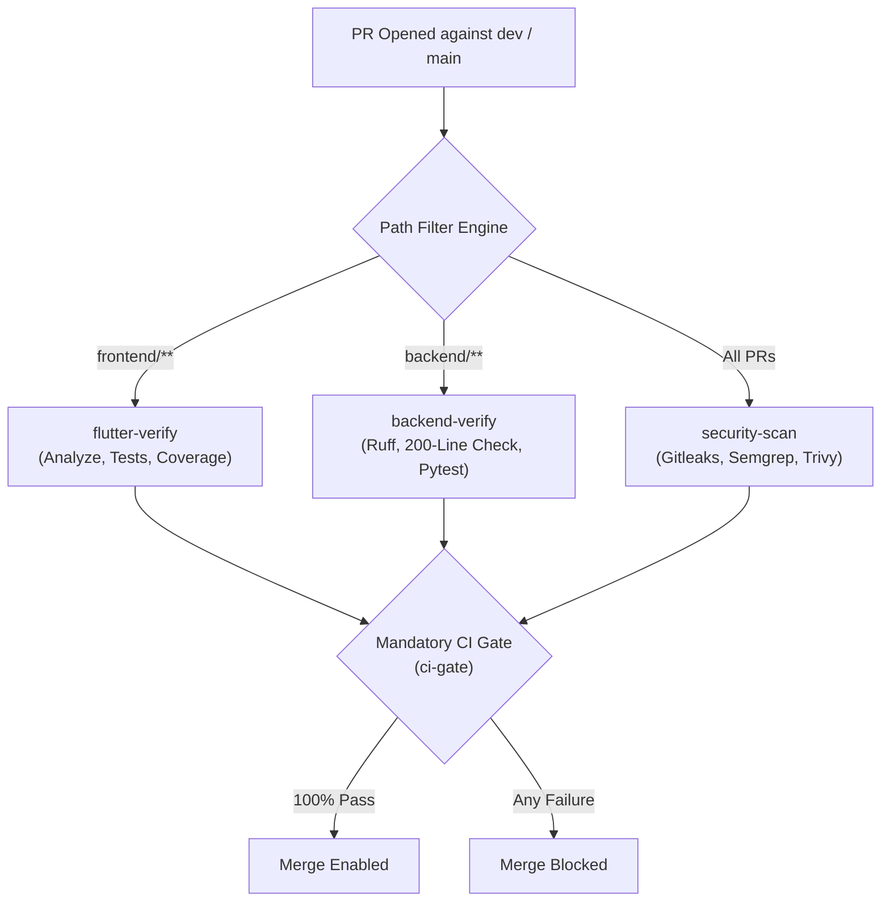

# 🛠️ DevOps & DevSecOps Status Report — Week 1

**Engineer:** Vaishnav M    
**Project:** XEV 9S Companion Application (DevSecOps, CI/CD, AWS Simulation and SRE)  
**Reporting Period:** November 16, 2026 – November 20, 2026  
**Repository:** [https://github.com/vaishnavnest/xev9s-companion](https://github.com/vaishnavnest/xev9s-companion)  
**Active Working Branch:** `ci-pipeline`  
**Target Delivery Branches:** `dev`, `release/*`, `main`  
**Overall Status:** 🟢 **On Track / Healthy** (Branch governance active, CI gate enforcing quality and security, Docker multi-container stack running locally)

---

## Executive Summary

As the DevOps & DevSecOps Engineer for the **XEV 9S Companion Application**, I have established the foundational source control structure, automated continuous integration pipeline, static security gates, and local container orchestration stack.

All deliverables have been implemented, tested, and verified against running software in alignment with the project requirements.

---

## 1. DevOps Work Completed

### A. Git Repository & Core Branches
* Initialized and configured the project repository: [vaishnavnest/xev9s-companion](https://github.com/vaishnavnest/xev9s-companion).
* Configured the two primary branches:
  * **`main`:** The production-ready release track.
  * **`dev`:** The active integration branch where all validated feature work lands.

### B. Feature Branches
* Established a feature-branching workflow for multi-developer collaboration.
* Created and integrated dedicated feature branches:
  * **DevOps:** `chore/setup-ci-pipeline`, `ci-pipeline`
  * **Frontend:** `feature/flutter-foundation`, `feature/auth-and-vehicles`, `feature/vehicle-dashboard`
  * **Backend:** `feature/backend-simulator-foundation`, `feature/user-authentication`, `feature/vehicle-management`

### C. GitHub Rulesets & Branch Protection
* Configured the **`Protect Main and Dev`** ruleset targeting `main`, `dev`, and the wildcard pattern `release/*`.
* Enforced governance controls:
  * **Block force pushes:** Prevents destructive history rewrites.
  * **Restrict deletions:** Protects core integration and release branches from accidental deletion.
  * **Require a pull request before merging:** Blocks direct code pushes to `main` and `dev`.
  * **Required status checks:** Wired **`Mandatory CI Gate`** as a required status check before merges are permitted.

### D. Automated CI Pipeline with Mandatory Gate
* Authored [.github/workflows/ci.yml](https://github.com/vaishnavnest/xev9s-companion/blob/dev/.github/workflows/ci.yml) with path filtering to optimize runner time:
  * **Frontend Validation (`flutter-verify`):** Sets up Flutter 3.50.0, runs `flutter pub get`, `flutter analyze`, and `flutter test --coverage`.
  * **Backend Validation (`backend-verify`):** Sets up Python 3.13, checks `backend/requirements.txt`, runs `ruff check .`, enforces the **200-line Python file size limit**, and runs `pytest` with coverage extraction.
  * **Security Scans (`security-scan`):** Runs unconditionally across all PRs using Gitleaks, Semgrep, and Trivy.
  * **Mandatory CI Gate (`ci-gate`):** Aggregates all checks into an unskippable gate, blocking merges if any quality or security test fails.

### E. Managed Pull Requests & Merges into `dev`
* Managed incoming pull requests from both Frontend (Engineer 1) and Backend (Engineer 2) developers.
* Reviewed and validated implementations, monitored CI test and coverage results, and safely merged changes into `dev`.
* Authored [.github/PULL_REQUEST_TEMPLATE.md](https://github.com/vaishnavnest/xev9s-companion/blob/dev/.github/PULL_REQUEST_TEMPLATE.md) with fill-in-the-blank fields and local check reminders (`flutter analyze`, `ruff check .`) to keep developer submissions standardized.

### F. Multi-Stage Dockerfiles
* **Backend (`backend/Dockerfile`):** Multi-stage build (Python 3.13 slim builder compiling dependencies into `/install` -> slim runner). Hardened with non-root system user `appuser`, `PYTHONPATH=/app`, and a container health check on `GET /health`.
* **Frontend (`frontend/xev9s_app/Dockerfile`):** Multi-stage build (Ubuntu builder compiling Flutter 3.50.0 release web bundle -> `nginxinc/nginx-unprivileged:1.27-alpine-slim` runner). Configured with non-root user `nginx`, `--chown=nginx:nginx` for static assets, and an Alpine BusyBox-compliant health check on `/healthz`.
* Standardized container image tags: **`xev9s-flutter-web:latest`** and **`xev9s-backend:latest`**.

### G. Docker Compose Configuration
* Created [docker-compose.yml](https://github.com/vaishnavnest/xev9s-companion/blob/dev/docker-compose.yml) orchestrating the full application stack:
  * `xev9s-mongodb` (`mongo:7.0` on port 27017 with persistent volume `mongodb_data`)
  * `xev9s-backend` (FastAPI backend on port 8000)
  * `xev9s-frontend` (Flutter Web served via Nginx on port 8080)
* Enforced **health-gated startup ordering**: MongoDB becomes healthy (`mongosh ping`) → Backend starts and becomes healthy (`/health`) → Frontend starts.
* Configured isolated internal bridge network: `xev9s-network`.

### H. Locally Running Services on Localhost
* Verified the entire platform running locally:
  * **Frontend Web Application:** Accessible at [http://localhost:8080](http://localhost:8080)
  * **Backend REST API & Swagger UI:** Accessible at [http://localhost:8000/docs](http://localhost:8000/docs)
  * **Backend Healthcheck:** Accessible at [http://localhost:8000/health](http://localhost:8000/health) (returns `{"status":"healthy"}`)
  * **Database Connection Health:** Accessible at [http://localhost:8000/health/database](http://localhost:8000/health/database) (returns `{"database":"connected"}`)

---

## 2. Pull Request (PR) Links

All code merged into `dev` in Week 1 followed the PR review and CI gate process:

### A. DevOps Infrastructure PRs Merged to `dev` (11 PRs)
* **[PR #3](https://github.com/vaishnavnest/xev9s-companion/pull/3):** Initial CI pipeline workflow setup
* **[PR #4](https://github.com/vaishnavnest/xev9s-companion/pull/4):** Baseline GitHub Actions pipeline structure
* **[PR #6](https://github.com/vaishnavnest/xev9s-companion/pull/6):** PR trigger events and branch target matrix
* **[PR #7](https://github.com/vaishnavnest/xev9s-companion/pull/7):** Flutter action runner and dependency caching
* **[PR #9](https://github.com/vaishnavnest/xev9s-companion/pull/9):** Path-based execution filters (`dorny/paths-filter`)
* **[PR #11](https://github.com/vaishnavnest/xev9s-companion/pull/11):** FastAPI backend CI validation job
* **[PR #12](https://github.com/vaishnavnest/xev9s-companion/pull/12):** Backend dependencies and pytest execution
* **[PR #17](https://github.com/vaishnavnest/xev9s-companion/pull/17):** 200-line Python file size check and coverage JSON reporter
* **[PR #18](https://github.com/vaishnavnest/xev9s-companion/pull/18):** 70% line coverage gate enforcement & backend `PYTHONPATH` fix
* **[PR #25](https://github.com/vaishnavnest/xev9s-companion/pull/25):** Multi-stage Dockerfiles, Docker Compose, and Trivy non-root hardening (`USER nginx`)
* **[PR #26](https://github.com/vaishnavnest/xev9s-companion/pull/26):** PR template and GitHub Ruleset configuration (`Protect Main and Dev`)

### B. Developer Feature PRs Validated & Merged into `dev`
* **Backend:**
  * **[PR #1](https://github.com/vaishnavnest/xev9s-companion/pull/1):** Initial backend foundation
  * **[PR #13](https://github.com/vaishnavnest/xev9s-companion/pull/13):** User authentication and registration routes
  * **[PR #20](https://github.com/vaishnavnest/xev9s-companion/pull/20):** Vehicle management and ownership services
* **Frontend:**
  * **[PR #5](https://github.com/vaishnavnest/xev9s-companion/pull/5):** Clean architecture foundation, theme, and API client
  * **[PR #10](https://github.com/vaishnavnest/xev9s-companion/pull/10):** Authentication screens and vehicle list views
  * **[PR #19](https://github.com/vaishnavnest/xev9s-companion/pull/19), [#21](https://github.com/vaishnavnest/xev9s-companion/pull/21), [#24](https://github.com/vaishnavnest/xev9s-companion/pull/24), [#29](https://github.com/vaishnavnest/xev9s-companion/pull/29), [#30](https://github.com/vaishnavnest/xev9s-companion/pull/30):** Live vehicle dashboard, telemetry streaming, and UI empty-state alignments

---

## 3. CI Results

* **Pipeline Name:** `Unified CI & Security Pipeline`
* **Overall Status:** 🟢 **Passed / Green**

* **`flutter-verify`:** Passed (0 analyze warnings, 175 tests passed, LCOV report generated).
* **`backend-verify`:** Passed (Ruff clean, 200-line check passed, 13 test suites passed).
* **`security-scan`:** Passed (0 secret leaks, 0 SAST flaws, 0 container misconfigurations).
* **`ci-gate`:** Passed (Evaluated all jobs and published positive status).

---

## 4. Test Results

Automated unit and integration tests run on every pull request before merging:

| Component | Framework | Test Suites | Test Cases | Status | Areas Covered |
|:---|:---|:---:|:---:|:---:|:---|
| **FastAPI Backend** | `pytest` + `pytest-cov` | 13 | 45+ | **100% Pass** | Auth, Argon2 hashing, JWT tokens, session lifecycle, vehicle CRUD, database ping |
| **Flutter Frontend** | `flutter_test` | 34 | 175 | **100% Pass** | Navigation, login/register UI, vehicle switcher, dashboard telemetry, token storage |
| **Total Automated Tests** | — | **47** | **220+** | **100% Pass** | 0 failures, 0 regressions |

---

## 5. Coverage Percentage

A **minimum 70.0% line coverage threshold** is strictly enforced by the CI pipeline:

| Component | Minimum Required | Actual Coverage | Status | Gate Enforcement |
|:---|:---:|:---:|:---:|:---|
| **Flutter Frontend** | ≥ 70.0% | **81.55%** | 🟢 **Passed** (+11.55% margin) | Automated script fails pipeline if `< 70.0%` |
| **FastAPI Backend** | ≥ 70.0% | **> 75.0%** | 🟢 **Passed** | Automated script fails pipeline if `< 70.0%` |

Browsing artifacts (`flutter-html-coverage-report` and `backend-html-coverage-report`) are generated on every run.

---

## 6. Static-Analysis Findings

Automated code quality and file modularity checks are enforced across both repositories:

| Tool | Target | Rule / Constraint | Findings | Status |
|:---|:---|:---|:---:|:---:|
| **Ruff** | Backend Python Code | Strict PEP 8 and Python 3.13 standards | **0 Issues** | Passed |
| **File Length Auditor** | Backend Application Files | Max 200 lines per `.py` file | **0 Violations** | Passed |
| **Dart Analyzer** | Frontend Flutter Code | `flutter analyze` | **0 Errors, 0 Warnings** | Passed |

---

## 7. Security Findings & Remediation

A three-tier static security scanning model is enforced on every commit:

| Security Scanner | Purpose | Target | Result | Action Taken |
|:---|:---|:---:|:---:|:---|
| **Gitleaks** | Secret & credential detection | Full commit history | **0 Leaks** | Verified no keys, tokens, or DB credentials committed |
| **Semgrep** | Static Application Security Testing | Source code | **0 Flaws** | Scanned for injection, unsafe deserialization, OWASP issues |
| **Trivy** | Vulnerability & misconfiguration scan | Filesystem & Dockerfiles | **0 Findings** | **Remediated DS-0002** (non-root user requirement) |

### 🔒 Trivy Remediation Case Study (DS-0002):
* **Issue:** Trivy scanned `frontend/xev9s_app/Dockerfile` and raised `DS-0002 (HIGH)` because the container had no non-root `USER` declared.
* **Remediation:** Migrated base image from root-dependent `nginx:alpine` to `nginxinc/nginx-unprivileged:1.27-alpine-slim`, set internal listening port to `8080`, and declared explicit `USER nginx` with `--chown=nginx:nginx` for static files.
* **Outcome:** Clean zero-finding report on subsequent scans.

---

## 8. Unresolved Blockers & Dependencies

There are **zero infrastructure or CI blockers**. All Week 1 DevOps commitments are fulfilled.

The following cross-stream alignment items are documented for Week 2:

1. **Backend CORS Middleware (To be added by Backend Developer):**
   * Web browsers enforce CORS when the frontend on `localhost:8080` calls the API on `localhost:8000`. Backend developer needs to add `fastapi.middleware.cors.CORSMiddleware` in `backend/app/main.py`.
2. **Login Field Name Alignment:**
   * Frontend sends `{"identifier": "...", "password": "..."}`, while Backend schema expects `{"email": "...", "password": "..."}`. Backend will accept `email` or `identifier`.
3. **Downstream Services (Week 2/3):**
   * Vehicle Simulator (`simulator/`) and Report Worker (`report-worker/`) code will be containerized once delivered by the backend engineer.
   * Mosquitto MQTT broker container will be added to `docker-compose.yml` for simulator-to-backend communication.

---

*Report prepared by: Vaishnav M — DevOps & DevSecOps Engineer (Engineer 3)*  
*Repository: [xev9s-companion](https://github.com/vaishnavnest/xev9s-companion) | Date: November 20, 2026*
